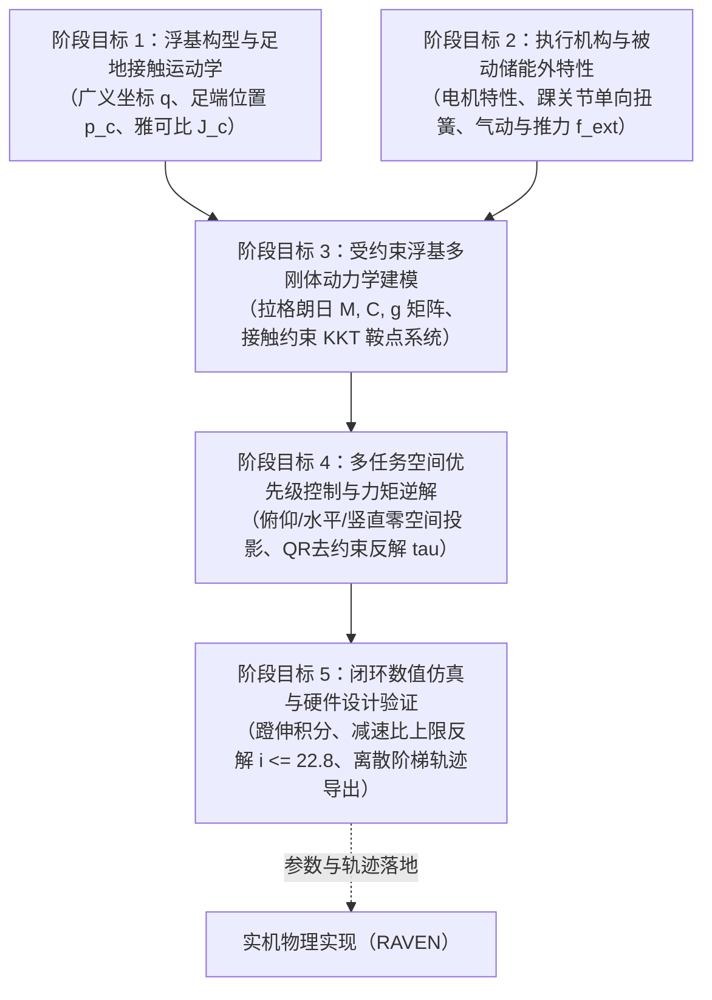

# X-Y矢状面跳跃起跳的动力学建模和仿真

> 本规范严格对齐论文 *Fast ground-to-air transition with avian-inspired multifunctional legs* 的 **Methods — Dynamics modeling and simulation（pp. 13–16，式 (2)–(23)）**，并与 `plan/milestone.md`（Step 1 → Step 5）保持一致。
>
> * **单一事实来源**：物理量的数值与单位只写在 `config/robot_paras.yaml`；本规范只给符号、公式与键名映射。验收阈值只写在 `plan/milestone.md`。
> * **符号优先**：符号含义以 [第 0 章 §0.2](spec/00_读法与符号速查.md) 为准；同一公式只在一处定稿，别处以链接或「见 §x.y」引用。
> * **先结论后推导**：每一章及含公式的小节，开篇先给出**结论**（实现可直接对照的定稿公式 / 判据），再按逻辑逐步写**推导**。
> * **历史命名**：YAML 中 `P_wz_m` / `P_tz_m` 和 `d_z` 的 `z` 表示**竖直方向**（旧约定）；本规范竖直轴为 \(+Y\)，故写作 \(P_{w,y}\)、\(d_y\)，数值与量纲不变，映射见 [第 0 章 §0.5](spec/00_读法与符号速查.md)。`plan/milestone.md` 中的 \(F_z\) 同样指竖直地面反力，对应本文 \(F_y\)。
> * **待确认项**：论文未公开的参数一律登记在 [missing_params_log.md](missing_params_log.md)，本规范不填任何经验值。

---

## 阶段性目标与逻辑架构

在论文原型的地面到空中快速转换（Fast ground-to-air transition）任务中，动力学仿真不只是简单的正向数值演化，其核心目的在于**验证物理设计可行性**、**反解关键传动参数（减速比）**，并**生成实机能够执行的离线控制轨迹**。

整套建模与仿真体系围绕以下 **5 大阶段性目标** 递进展开：

### 阶段目标 1：浮基构型与足地离散接触运动学建模（Kinematic & Contact Modeling）
* **核心任务**：建立机身与双腿在 X-Y 矢状面内的 6 自由度浮基运动链，描述足掌（Palm）与趾尖（Claw）的多点几何接触，推导足端接触雅可比矩阵及其时间导数。
* **产出参数与数据**：
  * 广义坐标 \(\mathbf{q} \in \mathbb{R}^6\) 与绝对姿态变换关系；
  * 足端关键接触点在惯性系下的位置 \(\mathbf{p}_c\)；
  * 接触雅可比矩阵 \(\mathbf{J}_c\) 及其时间导数 \(\dot{\mathbf{J}}_c\)；
  * 分阶段足底非滑动接触约束方程（双点贴地约束 \(\to\) 趾尖单点滚动约束）。
* **牵引与展开章节**：[第 0 章](spec/00_读法与符号速查.md)、[第 1 章](spec/01_脚爪的运动学方程与接触约束.md)、[附录 A](spec/appendices/附录A_雅可比矩阵权重推导.md)、[附录 C](spec/appendices/附录C_运动学与雅可比入门导读.md)。

### 阶段目标 2：执行机构外特性与关节被动储能动力学建模（Actuator & Passive Compliance Modeling）
* **核心任务**：构建跳跃动力来源与储能释放模型，涵盖无刷直流电机（BLDC）的转速-力矩外特性、行星减速箱与同步带传动损耗、单向嵌位踝关节储能扭簧及被动趾关节弹簧，以及机翼/尾翼气动力和前置螺旋桨拉力。
* **产出参数与数据**：
  * 电机饱和转矩与空载极限转速包络；
  * 踝关节扭簧的单向储能释放力矩 \(\tau_a\) 与趾关节复位弹簧力矩 \(\tau_t\)；
  * 机身合成外力向量 \(\mathbf{f}_{ext} = \mathbf{f}_p + \mathbf{f}_w + \mathbf{f}_t + \boldsymbol{\tau}_a + \boldsymbol{\tau}_t\)。
* **牵引与展开章节**：[第 2 章](spec/02_关节扭簧与执行器外特性模型.md)。

### 阶段目标 3：受约束浮基多刚体系统动力学方程组装（Constrained Multibody Dynamics）
* **核心任务**：基于拉格朗日力学体系，推导并组装含接触内力与广义惯性力的系统动力学方程，构建触地蹬伸期的微分-代数方程（DAE）及 KKT 鞍点求解体系，并处理多接触模态离散切换。
* **产出参数与数据**：
  * 质量与惯量矩阵 \(\mathbf{M}(\mathbf{q})\)；
  * 科氏力与离心力矩阵 \(\mathbf{C}(\mathbf{q}, \dot{\mathbf{q}})\)；
  * 重力向量 \(\mathbf{g}(\mathbf{q})\)；
  * 地面法向与切向反力向量 \(\mathbf{f}_c\)（含单边接触条件 \(F_y \ge 0\) 与摩擦锥约束 \(\lvert F_x \rvert \le \mu F_y\)）；
  * 离散模态碰撞重置映射（接触冲击瞬态速度跃变）。
* **牵引与展开章节**：[第 3 章](spec/03_浮基多体动力学方程.md)、[第 5 章](spec/05_混合系统切换与碰撞重置.md)、[附录 D](spec/appendices/附录D_运动方程直观解释.md)。

### 阶段目标 4：多任务空间优先级控制与力矩逆解（Task-Space Control & Inverse Dynamics）
* **核心任务**：以起跳目标状态（离地合速度 \(2.5\text{ m/s}\)、离地俯仰角速度 \(\dot{q}_3 \approx 0\)）为导向，建立机身俯仰角（优先级 1）、水平位移（优先级 2）、竖直位移（优先级 3）的零空间投影控制律，并通过 QR 分解消除地面接触反力，逆解求解关节电机驱动力矩。
* **产出参数与数据**：
  * 任务空间期望加速度与各级零空间投影矩阵 \(\mathbf{N}_i\)；
  * 满足多任务期望的广义坐标加速度 \(\ddot{\mathbf{q}}_d\)；
  * 驱动电机的逆动力学前馈力矩向量 \(\boldsymbol{\tau} = [\tau_{\text{hip}}, \tau_{\text{ankle}}]^T\) 历程。
* **牵引与展开章节**：[第 4 章](spec/04_优先级控制与力矩反解.md)。

### 阶段目标 5：闭环数值仿真、减速比反解与实机控制轨迹提取（Forward Simulation, Gear Ratio & Sim-to-Real）
* **核心任务**：对完整起跳蹬伸过程进行高精度闭环数值积分（ODE 积分与 Baumgarte 漂移抑制），提取极限工况运动学参数用于硬件参数闭环设计（反解减速比上限），并将仿真得到的连续运动轨迹转换为实机能够执行的离线控制指令。
* **产出参数与数据**：
  * **传动比设计关键参数**：起跳过程关节所需最大角速度极值（\(4384^\circ/\text{s}\)）、理论减速比上限（\(i \le 22.8\)）与最终工程选定值（\(1:19.13\)）；
  * **实机离线参考轨迹**：髋/踝关节离散阶梯速度控制指令（discrete step functions）；
  * **起跳协调时序优化**：髋关节激活动态延迟时间（避免双关节突加引起同步带打滑）；
  * **起跳关键状态参数**：起跳离地时间（约 \(0.17\text{ s}\)）、离地瞬时合速度（约 \(2.4\sim 2.5\text{ m/s}\)）及位姿演化历程。
* **牵引与展开章节**：[第 6 章](spec/06_数值求解与仿真规范.md)、[第 7 章](spec/07_起跳仿真与减速比计算.md)、[第 8 章](spec/08_验证基准与里程碑映射.md)。

---

## 正文各章目录（按阶段目标系统化展开）

| 对应阶段目标 | 章节 | 文件 | 核心内容 | 对应论文式号 | 对应里程碑 |
|---|---|---|---|---|---|
| **前置基础** | **第 0 章** | [00_读法与符号速查.md](spec/00_读法与符号速查.md) | 读法、全局符号速查、论文式号索引、建模假设、YAML 键名映射 | 全文总索引 | 全程 |
| **目标 1**：运动学与接触约束 | **第 1 章** | [01_脚爪的运动学方程与接触约束.md](spec/01_脚爪的运动学方程与接触约束.md) | 爪尖惯性系速度/加速度推导（运动链、正运动学、解析雅可比与 \(\dot{\mathbf{J}}\)）；分阶段无滑移接触约束方程 | 式 (2)–(7), (9) | Step 1 |
| **目标 2**：执行器与储能外力 | **第 2 章** | [02_关节扭簧与执行器外特性模型.md](spec/02_关节扭簧与执行器外特性模型.md) | 执行器与扭簧：电机转速-力矩包络、同步带与齿轮箱传动比、单向储能踝扭簧、被动脚趾扭簧、气动/推力外力合成 | 式 (11) | Step 2 |
| **目标 3**：多体动力学建模 | **第 3 章** | [03_浮基多体动力学方程.md](spec/03_浮基多体动力学方程.md) | 浮基多体动力学：各刚体质心位置、拉格朗日 \(\mathbf{M},\mathbf{C},\mathbf{g}\) 矩阵组装、触地 KKT 鞍点方程、腾空方程 | 式 (8), (10), (23) | Step 3 |
| **目标 4**：控制与力矩逆解 | **第 4 章** | [04_优先级控制与力矩反解.md](spec/04_优先级控制与力矩反解.md) | 控制与力矩反解：任务空间 PD、零空间优先级递推、QR 分解去约束反解 \(\boldsymbol{\tau}\)、执行器饱和校验 | 式 (12)–(22) | Step 4 |
| **目标 3**：接触状态机与重置 | **第 5 章** | [05_混合系统切换与碰撞重置.md](spec/05_混合系统切换与碰撞重置.md) | 混合系统切换：离散模态图、事件 E1–E3 判据、碰撞重置映射、单边接触与摩擦锥校验 | 接触状态机 | Step 4 |
| **目标 5**：数值积分与求解 | **第 6 章** | [06_数值求解与仿真规范.md](spec/06_数值求解与仿真规范.md) | 数值求解与仿真规范：KKT 鞍点求解、Baumgarte 漂移稳定化、ODE 积分与事件检测、初始静平衡校验 | 数值求解层 | Step 3–4 |
| **目标 5**：闭环仿真与减速比 | **第 7 章** | [07_起跳仿真与减速比计算.md](spec/07_起跳仿真与减速比计算.md) | 起跳闭环仿真：全流程蹬伸积分、关节最大角速度极值提取、电机空载极速边界与减速比上限反解（\(i \le 22.8 \to 19.13\)） | 减速比设计闭环 | Step 4–5 |
| **目标 5**：验证基准与代码映射 | **第 8 章** | [08_验证基准与里程碑映射.md](spec/08_验证基准与里程碑映射.md) | 里程碑代码模块映射（Step 1 → Step 5）与数学/物理一致性验证清单（V&V）、实机离散参考轨迹落地校验 | 验收与对标 | Step 1–5 |

---

## 独立附录目录

| 附录 | 文件 | 定位与内容 |
|---|---|---|
| **附录 A** | [附录A_雅可比矩阵权重推导.md](spec/appendices/附录A_雅可比矩阵权重推导.md) | 雅可比矩阵（由爪尖线速度中广义坐标的权重定义与极限工况检验） |
| **附录 B** | [附录B_机身质心偏移可行域.md](spec/appendices/附录B_机身质心偏移可行域.md) | 机身质心偏移 \((d_x,d_y)\) 可行域论证 |
| **附录 C** | [附录C_运动学与雅可比入门导读.md](spec/appendices/附录C_运动学与雅可比入门导读.md) | 正运动学与雅可比入门导读（小白向，对应阶段目标 1） |
| **附录 D** | [附录D_运动方程直观解释.md](spec/appendices/附录D_运动方程直观解释.md) | 运动方程直观解释与量纲核对（小白向，对应阶段目标 3） |

---

## 推荐阅读与开发路径

* **直觉入门**：[附录 C（运动学直觉）](spec/appendices/附录C_运动学与雅可比入门导读.md) → [附录 D（动力学直觉）](spec/appendices/附录D_运动方程直观解释.md) → [第 0 章](spec/00_读法与符号速查.md)。
* **Step 1（实现阶段目标 1：接触运动学）**：[第 0 章](spec/00_读法与符号速查.md) → [第 1 章](spec/01_脚爪的运动学方程与接触约束.md) → [第 8 章 §8.1](spec/08_验证基准与里程碑映射.md)；补充推导见 [附录 A](spec/appendices/附录A_雅可比矩阵权重推导.md) 与 [附录 B](spec/appendices/附录B_机身质心偏移可行域.md)。
* **Step 2（实现阶段目标 2：扭簧与执行器外特性）**：[第 2 章](spec/02_关节扭簧与执行器外特性模型.md) → `tests/test_step2.py`。
* **Step 3（实现阶段目标 3：多体动力学与 KKT 方程）**：[第 3 章](spec/03_浮基多体动力学方程.md) → [第 6 章 §6.1–§6.2](spec/06_数值求解与仿真规范.md) → [第 8 章 §8.2](spec/08_验证基准与里程碑映射.md)。
* **Step 4（实现阶段目标 4：多任务控制与逆动力学解算）**：[第 4 章](spec/04_优先级控制与力矩反解.md) → [第 5 章](spec/05_混合系统切换与碰撞重置.md) → `tests/test_step4.py`。
* **Step 5（实现阶段目标 5：闭环仿真、减速比闭环与实机轨迹导出）**：[第 6 章](spec/06_数值求解与仿真规范.md) → [第 7 章（起跳极速与减速比计算）](spec/07_起跳仿真与减速比计算.md) → [第 8 章](spec/08_验证基准与里程碑映射.md) → 完成 Sim-to-Real 参数闭环。
