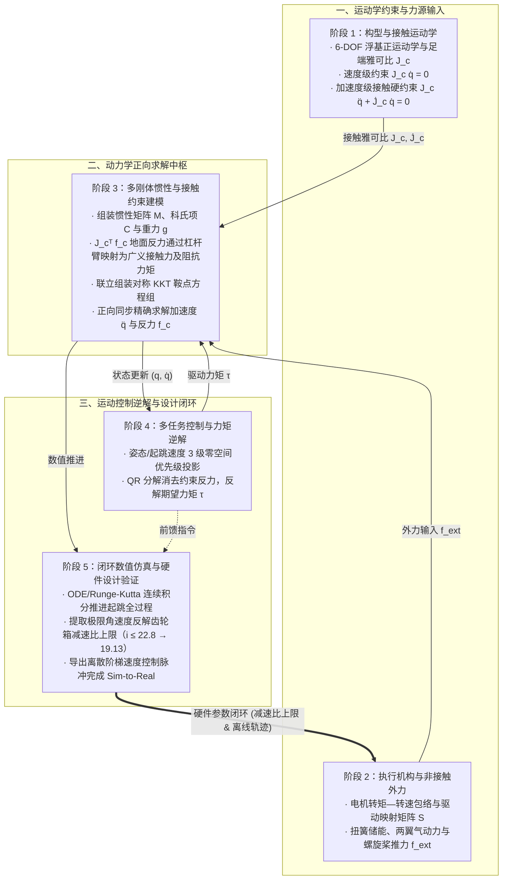
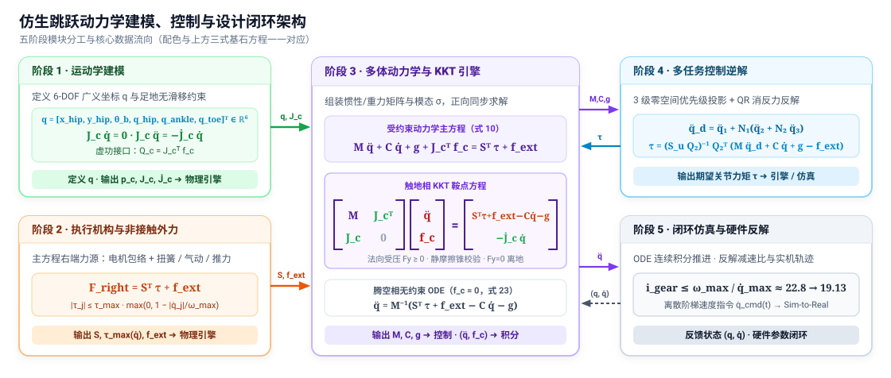

# X-Y矢状面跳跃起跳的动力学建模和仿真

> 本规范严格对齐论文 *Fast ground-to-air transition with avian-inspired multifunctional legs* 的 **Methods — Dynamics modeling and simulation（pp. 13–16，式 (2)–(23)）**，并与 `plan/milestone.md`（Step 1 → Step 5）保持一致。
>
> * **单一事实来源**：物理量的数值与单位只写在 `config/robot_paras.yaml`；本规范只给符号、公式与键名映射。验收阈值只写在 `plan/milestone.md`。
> * **符号优先**：符号含义以 [第 0 章 §0.2](spec/00_读法与符号速查.md) 为准；同一公式只在一处定稿，别处以链接或「见 §x.y」引用。
> * **先产出后推导**：每一章及含公式的小节，开篇先给出**核心产出与定稿公式**（实现可直接对照的定义、公式与判据），再按逻辑逐步写**推导**。
> * **历史命名**：YAML 中 `P_wz_m` / `P_tz_m` 和 `d_z` 的 `z` 表示**竖直方向**（旧约定）；本规范竖直轴为 \(+Y\)，故写作 \(P_{w,y}\)、\(d_y\)，数值与量纲不变，映射见 [第 0 章 §0.5](spec/00_读法与符号速查.md)。`plan/milestone.md` 中的 \(F_z\) 同样指竖直地面反力，对应本文 \(F_y\)。
> * **待确认项**：论文未公开的参数一律登记在 [missing_params_log.md](missing_params_log.md)，本规范不填任何经验值。

---

## 阶段性目标与逻辑架构

> **指标口径提示**：论文正文中的近似整机质量约 `0.6 kg`，实机称量与仿真简化模型质量见 `config/robot_paras.yaml`，不能互换。文中控制目标所写的离地合速度约 `2.5 m/s` 与里程碑工况 B 的水平速度约 `2.20 m/s` 是不同量；比较时按 `plan/milestone.md` 的测量定义分别报告。论文基准值及项目操作性测量口径也须分栏记录，不应将项目定义表述为论文原口径。

在地面到空中快速转换任务中，动力学仿真核心承载三大目标：**验证机构物理可行性**、**反解减速比设计边界**与**生成真机执行的离线轨迹**。整套体系由牛顿—拉格朗日多刚体动力学驱动，所有公式与算法围绕以下基石方程展开（动力学主方程、速度级与加速度级接触硬约束方程）：

$$
\underbrace{\mathbf{M}(\mathbf{q})\ddot{\mathbf{q}} + \mathbf{C}(\mathbf{q},\dot{\mathbf{q}})\dot{\mathbf{q}} + \mathbf{g}(\mathbf{q})}_{\text{③-a 多刚体惯性与重力项}} + \underbrace{\mathbf{J}_c^T(\mathbf{q})\mathbf{f}_c}_{\text{③-b 地面反力通过杠杆臂映射至机身与各关节的广义接触力及阻抗力矩}} = \underbrace{\mathbf{S}^T\boldsymbol{\tau}}_{\text{②-a 电机驱动（由④反解）}} + \underbrace{\mathbf{f}_{\text{ext}}}_{\text{②-b 扭簧+气动+推力}}
$$

$$
\underbrace{\dot{\mathbf{p}}_c = \mathbf{J}_c(\mathbf{q})\dot{\mathbf{q}} = \mathbf{0}}_{\text{①-a 速度级接触硬约束（式 (2)）：无滑动与速度基准守恒、碰撞重置与漂移抑制依据}}
$$

$$
\underbrace{\ddot{\mathbf{p}}_c = \mathbf{J}_c(\mathbf{q})\ddot{\mathbf{q}} + \dot{\mathbf{J}}_c(\mathbf{q},\dot{\mathbf{q}})\dot{\mathbf{q}} = \mathbf{0}}_{\text{①-b 加速度级接触硬约束（式 (3)）：脚掌贴地/滚转时不陷地、不打滑，与主方程联立解算}}
$$

### 5 大阶段逻辑与闭环数据流

### 阶段核心目标与产出速查

| 阶段目标 | 方程映射 | 核心任务与物理直觉 | 核心产出数据 |
|---|---|---|---|
| **阶段 1：构型与接触运动学** | 约束方程 \(\mathbf{J}_c\dot{\mathbf{q}} = \mathbf{0}\) 与 \(\mathbf{J}_c\ddot{\mathbf{q}} + \dot{\mathbf{J}}_c\dot{\mathbf{q}} = \mathbf{0}\) | 搭建无重量几何骨架，建立脚掌双点贴地与单点滚转的速度级与加速度级非滑移硬约束 | 广义坐标 \(\mathbf{q}\)、足端雅可比 \(\mathbf{J}_c\) 及其导数 \(\dot{\mathbf{J}}_c\)、速度/加速度级约束方程 |
| **阶段 2：执行机构与外力建模** | 等号右端 \(\mathbf{S}^T\boldsymbol{\tau} + \mathbf{f}_{\text{ext}}\) | 清点驱动与储能极限，整合电机转矩—转速包络、扭簧储能、气动力与螺旋桨推力 | 驱动矩阵 \(\mathbf{S}\)、饱和包络 \(\tau_{\max}(\dot{\mathbf{q}})\)、广义外力 \(\mathbf{f}_{\text{ext}}\) |
| **阶段 3：多体惯性与物理引擎** | 等号左端 \(\mathbf{M}\ddot{\mathbf{q}} + \mathbf{C}\dot{\mathbf{q}} + \mathbf{g} + \mathbf{J}_c^T\mathbf{f}_c\) | 赋予各连杆质量与转动惯量，将地面反力经杠杆臂 \(\mathbf{J}_c^T\) 映射为广义接触力及阻抗力矩，联立阶段 1、2 组装 KKT 鞍点方程正向求解物理状态 | 惯性矩阵 \(\mathbf{M}\)、科氏项 \(\mathbf{C}\dot{\mathbf{q}}\)、重力 \(\mathbf{g}\)、加速度 \(\ddot{\mathbf{q}}\) 与反力 \(\mathbf{f}_c\) |
| **阶段 4：多任务控制与力矩逆解** | 反解等号右端力矩 \(\boldsymbol{\tau}\) | 打造控制大脑：姿态稳定 \(\to\) 水平加速 \(\to\) 竖直加速分级投影，QR 分解去反力反解电机扭矩 | 投影矩阵 \(\mathbf{N}_i\)、期望加速度 \(\ddot{\mathbf{q}}_d\)、关节前馈力矩 \(\boldsymbol{\tau}\) |
| **阶段 5：闭环仿真与硬件反解** | 连续积分 \(\ddot{\mathbf{q}} \to \dot{\mathbf{q}} \to \mathbf{q}\) | 驱动物理引擎跑完全程，提取极限角速度反解减速比，生成实机离散脉冲轨迹 | 减速比上限（\(i \le 22.8 \to 19.13\)）、离地速度（\(2.5\text{ m/s}\)）、实机阶梯速度指令 |

---

## 正文各章目录（按阶段目标系统化展开）

| 对应阶段目标 | 章节 | 文件 | 核心内容 | 对应论文式号 | 对应里程碑 |
|---|---|---|---|---|---|
| **前置基础** | **第 0 章** | [00_读法与符号速查.md](spec/00_读法与符号速查.md) | 读法、全局符号速查、论文式号索引、建模假设、YAML 键名映射 | 全文总索引 | 全程 |
| **目标 1**：浮基构型与足地接触运动学 | **第 1 章** | [01_浮基构型与足地接触运动学.md](spec/01_浮基构型与足地接触运动学.md) | 爪尖惯性系速度/加速度推导（运动链、正运动学、解析雅可比与 \(\dot{\mathbf{J}}\)）；分阶段速度级与加速度级无滑移接触约束方程 | 式 (2)–(7), (9) | Step 1 |
| **目标 2**：执行机构与非接触外力建模 | **第 2 章** | [02_执行机构与非接触外力建模.md](spec/02_执行机构与非接触外力建模.md) | 方程右端力源与外特性：电机转速—力矩包络、驱动映射 \(\mathbf{S}\)、储能踝扭簧、被动趾扭簧、气动/推力外力合成 \(\mathbf{f}_{\text{ext}}\) | 式 (11) | Step 2 |
| **目标 3**：多刚体惯性与重力及接触约束建模 | **第 3 章** | [03_多刚体惯性与重力及接触约束建模.md](spec/03_多刚体惯性与重力及接触约束建模.md) | 方程左端多体耦合与约束组装：各刚体质心位置、拉格朗日 \(\mathbf{M},\mathbf{C},\mathbf{g}\) 矩阵组装、触地 KKT 鞍点方程、腾空方程 | 式 (8), (10), (23) | Step 3 |
| **目标 4**：多任务优先级控制与力矩逆解 | **第 4 章** | [04_多任务优先级控制与力矩逆解.md](spec/04_多任务优先级控制与力矩逆解.md) | 控制与力矩反解：任务空间 PD、零空间优先级递推、QR 分解去约束反解 \(\boldsymbol{\tau}\)、执行器饱和校验 | 式 (12)–(22) | Step 4 |
| **目标 3**：接触模态切换与碰撞重置 | **第 5 章** | [05_接触模态切换与碰撞重置.md](spec/05_接触模态切换与碰撞重置.md) | 离散模态图、事件 E1–E3 判据、碰撞重置映射、单边接触与摩擦锥校验 | 接触状态机 | Step 4 |
| **目标 5**：闭环数值求解与仿真规范 | **第 6 章** | [06_闭环数值求解与仿真规范.md](spec/06_闭环数值求解与仿真规范.md) | KKT 鞍点求解、Baumgarte 漂移稳定化、ODE 积分与事件检测、初始静平衡校验 | 数值求解层 | Step 3–4 |
| **目标 5**：起跳仿真与减速比反解 | **第 7 章** | [07_起跳仿真与减速比反解.md](spec/07_起跳仿真与减速比反解.md) | 全流程蹬伸积分、关节最大角速度极值提取、电机空载极速边界与减速比上限反解（\(i \le 22.8 \to 19.13\)） | 减速比设计闭环 | Step 4–5 |
| **目标 5**：硬件设计验证与里程碑映射 | **第 8 章** | [08_硬件设计验证与里程碑映射.md](spec/08_硬件设计验证与里程碑映射.md) | 里程碑代码模块映射（Step 1 → Step 5）与数学/物理一致性验证清单（V&V）、实机离散参考轨迹落地校验 | 验收与对标 | Step 1–5 |

---

## 独立附录目录

| 附录 | 文件 | 定位与内容 |
|---|---|---|
| **附录 A** | [附录A_雅可比矩阵权重推导.md](spec/appendices/附录A_雅可比矩阵权重推导.md) | 雅可比矩阵（由爪尖线速度中广义坐标的权重定义与极限工况检验） |
| **附录 B** | [附录B_机身质心偏移可行域.md](spec/appendices/附录B_机身质心偏移可行域.md) | 机身质心偏移 \((d_x,d_y)\) 可行域论证 |
| **附录 C** | [附录C_运动学与雅可比入门导读.md](spec/appendices/附录C_运动学与雅可比入门导读.md) | 正运动学与雅可比入门导读（小白向，对应阶段目标 1） |
| **附录 D** | [附录D_运动方程直观解释.md](spec/appendices/附录D_运动方程直观解释.md) | 运动方程直观解释与量纲核对（小白向，对应阶段目标 3） |

---

## 推荐阅读与开发路径

* **直觉入门**：[附录 C（运动学直觉）](spec/appendices/附录C_运动学与雅可比入门导读.md) → [附录 D（动力学直觉）](spec/appendices/附录D_运动方程直观解释.md) → [第 0 章](spec/00_读法与符号速查.md)。
* **Step 1（实现阶段目标 1：浮基构型与足地接触运动学）**：[第 0 章](spec/00_读法与符号速查.md) → [第 1 章](spec/01_浮基构型与足地接触运动学.md) → [第 8 章 §8.1](spec/08_硬件设计验证与里程碑映射.md)；补充推导见 [附录 A](spec/appendices/附录A_雅可比矩阵权重推导.md) 与 [附录 B](spec/appendices/附录B_机身质心偏移可行域.md)。
* **Step 2（实现阶段目标 2：执行机构与非接触外力建模）**：[第 2 章](spec/02_执行机构与非接触外力建模.md) → `tests/test_step2.py`。
* **Step 3（实现阶段目标 3：多刚体惯性与重力及接触约束建模）**：[第 3 章](spec/03_多刚体惯性与重力及接触约束建模.md) → [第 6 章 §6.1–§6.2](spec/06_闭环数值求解与仿真规范.md) → [第 8 章 §8.2](spec/08_硬件设计验证与里程碑映射.md)。
* **Step 4（实现阶段目标 4：多任务优先级控制与力矩逆解）**：[第 4 章](spec/04_多任务优先级控制与力矩逆解.md) → [第 5 章](spec/05_接触模态切换与碰撞重置.md) → `tests/test_step4.py`。
* **Step 5（实现阶段目标 5：闭环仿真、减速比闭环与实机轨迹导出）**：[第 6 章](spec/06_闭环数值求解与仿真规范.md) → [第 7 章（起跳仿真与减速比反解）](spec/07_起跳仿真与减速比反解.md) → [第 8 章](spec/08_硬件设计验证与里程碑映射.md) → 完成 Sim-to-Real 参数闭环。
