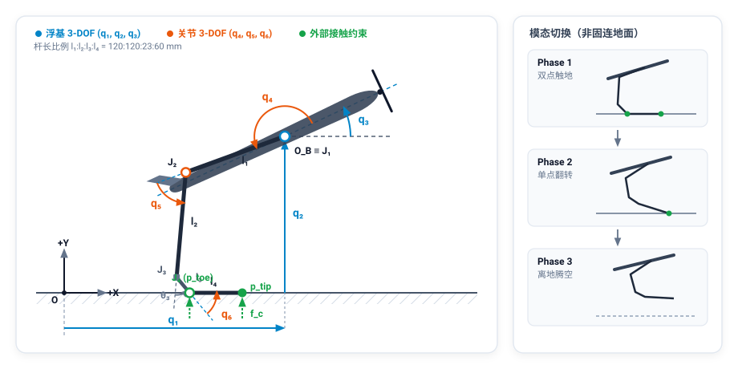

> 返回总目录：[paper_spec.md](../paper_spec.md) | 上一章：[第 0 章](00_读法与符号速查.md) | 下一章：[第 2 章](02_执行机构与非接触外力建模.md)

# 1. 浮基构型与足地接触运动学（阶段目标 1）

## 本章核心产出

本章在矢状面（\(X\text{-}Y\) 平面）建立机身与腿部的 6 自由度浮基开链运动学模型。本章针对跳跃起飞受约束动力学主方程，完成 **6 自由度广义坐标**的定义以及**足地接触几何约束与力映射矩阵**（接触雅可比 \(\mathbf{J}_c\) 及其导数 \(\dot{\mathbf{J}}_c\)）的解析建模；地面反力 \(\mathbf{f}_c\) 本身是未知约束反力（留待第 3 章联立 KKT 方程求解），本章建立的是将其映射至机身与各关节的几何杠杆接口 \(\mathbf{J}_c^T(\mathbf{q})\)：

$$
\mathbf{M}(\underbrace{\mathbf{q}}_{\text{本章定义的 6-DOF 广义坐标}})\ddot{\mathbf{q}} + \mathbf{C}(\mathbf{q},\dot{\mathbf{q}})\dot{\mathbf{q}} + \mathbf{g}(\mathbf{q}) + \underbrace{\mathbf{J}_c^T(\mathbf{q})}_{\text{本章建模的杠杆映射矩阵}}\mathbf{f}_c = \mathbf{S}^T\boldsymbol{\tau} + \mathbf{f}_{\text{ext}}
$$

本章核心产出包括以下两项：

### 1. 系统广义坐标的定义

系统 6 自由度广义坐标向量 \(\mathbf{q} \in \mathbb{R}^6\) 由 2 个机身平动坐标、1 个机身绝对俯仰角以及 3 个腿部相对关节转角构成：

$$
\mathbf{q} = \begin{bmatrix} q_1 \\ q_2 \\ q_3 \\ q_4 \\ q_5 \\ q_6 \end{bmatrix} = \begin{bmatrix} x_{\text{hip}} \\ y_{\text{hip}} \\ \theta_{\text{body}} \\ q_{\text{hip}} \\ q_{\text{ankle}} \\ q_{\text{toe}} \end{bmatrix}
$$

---

### 2. 广义接触反力映射

接触雅可比矩阵 \(\mathbf{J}_c(\mathbf{q})\) 正向用于建立足端无滑移的速度/加速度硬约束（\(\mathbf{J}_c\dot{\mathbf{q}}=\mathbf{0}\)、\(\mathbf{J}_c\ddot{\mathbf{q}}+\dot{\mathbf{J}}_c\dot{\mathbf{q}}=\mathbf{0}\)）；在跳跃起飞受约束动力学主方程（论文式 (10)）中，其转置 \(\mathbf{J}_c^T(\mathbf{q})\) 将地面接触反力 \(\mathbf{f}_c\) 映射为作用在 6 个自由度上的广义接触反力向量 \(\mathbf{J}_c^T(\mathbf{q})\mathbf{f}_c \in \mathbb{R}^6\)。

> [!NOTE] 广义接触力的简化中心与各分量界定
> 映射输出的 6 维广义接触力向量按浮基与关节分层界定简化中心：
> * **第 1、2 分量（平动主矢）**：将足地接触反力向简化中心——本体系原点（髋轴 \(O_B\)）简化后，作用线过 \(O_B\) 的平动合力（主矢，其大小与方向不随简化中心改变）。
> * **第 3 分量（俯仰主矩）**：接触反力对同一简化中心 \(O_B\) 的俯仰翻转合力矩（主矩）。
> * **第 4、5、6 分量（关节力矩）**：分别以各相对关节铰链轴心（髋 \(J_1\)、踝 \(J_2\)、趾 \(J_4\)）为简化中心，由该关节下游所受接触反力映射产生的关节阻抗力矩。

分模态显式展开如下：

#### (1) Phase 1：双点全足接触阶段（足掌与爪尖同时触地）

接触反力向量为 \(\mathbf{f}_c = [f_{\text{toe},x}, f_{\text{toe},y}, f_{\text{claw},x}, f_{\text{claw},y}]^T \in \mathbb{R}^4\)。雅可比矩阵转置乘以接触反力向量显式展开为：

$$
\mathbf{J}_{c,1}^T(\mathbf{q})\mathbf{f}_c = \begin{bmatrix}
1 & 0 & 1 & 0 \\
0 & 1 & 0 & 1 \\
J_{13}^{(\text{toe})} & J_{23}^{(\text{toe})} & J_{13}^{(\text{claw})} & J_{23}^{(\text{claw})} \\
J_{14}^{(\text{toe})} & J_{24}^{(\text{toe})} & J_{14}^{(\text{claw})} & J_{24}^{(\text{claw})} \\
J_{15}^{(\text{toe})} & J_{25}^{(\text{toe})} & J_{15}^{(\text{claw})} & J_{25}^{(\text{claw})} \\
0 & 0 & J_{16}^{(\text{claw})} & J_{26}^{(\text{claw})}
\end{bmatrix}
\begin{bmatrix}
f_{\text{toe},x} \\
f_{\text{toe},y} \\
f_{\text{claw},x} \\
f_{\text{claw},y}
\end{bmatrix}
= \begin{bmatrix}
f_{\text{toe},x} + f_{\text{claw},x} \\
f_{\text{toe},y} + f_{\text{claw},y} \\
J_{13}^{(\text{toe})} f_{\text{toe},x} + J_{23}^{(\text{toe})} f_{\text{toe},y} + J_{13}^{(\text{claw})} f_{\text{claw},x} + J_{23}^{(\text{claw})} f_{\text{claw},y} \\
J_{14}^{(\text{toe})} f_{\text{toe},x} + J_{24}^{(\text{toe})} f_{\text{toe},y} + J_{14}^{(\text{claw})} f_{\text{claw},x} + J_{24}^{(\text{claw})} f_{\text{claw},y} \\
J_{15}^{(\text{toe})} f_{\text{toe},x} + J_{25}^{(\text{toe})} f_{\text{toe},y} + J_{15}^{(\text{claw})} f_{\text{claw},x} + J_{25}^{(\text{claw})} f_{\text{claw},y} \\
J_{16}^{(\text{claw})} f_{\text{claw},x} + J_{26}^{(\text{claw})} f_{\text{claw},y}
\end{bmatrix}
$$

#### (2) Phase 2：单点翻转接触阶段（仅爪尖单点触地）

足掌抬离地面，接触反力向量退化为 \(\mathbf{f}_c = [f_{\text{claw},x}, f_{\text{claw},y}]^T \in \mathbb{R}^2\)。爪尖雅可比矩阵转置乘以接触反力向量显式展开为：

$$
\mathbf{J}_{c,2}^T(\mathbf{q})\mathbf{f}_c = \begin{bmatrix}
1 & 0 \\
0 & 1 \\
J_{13}^{(\text{claw})} & J_{23}^{(\text{claw})} \\
J_{14}^{(\text{claw})} & J_{24}^{(\text{claw})} \\
J_{15}^{(\text{claw})} & J_{25}^{(\text{claw})} \\
J_{16}^{(\text{claw})} & J_{26}^{(\text{claw})}
\end{bmatrix}
\begin{bmatrix}
f_{\text{claw},x} \\
f_{\text{claw},y}
\end{bmatrix}
= \begin{bmatrix}
f_{\text{claw},x} \\
f_{\text{claw},y} \\
J_{13}^{(\text{claw})} f_{\text{claw},x} + J_{23}^{(\text{claw})} f_{\text{claw},y} \\
J_{14}^{(\text{claw})} f_{\text{claw},x} + J_{24}^{(\text{claw})} f_{\text{claw},y} \\
J_{15}^{(\text{claw})} f_{\text{claw},x} + J_{25}^{(\text{claw})} f_{\text{claw},y} \\
J_{16}^{(\text{claw})} f_{\text{claw},x} + J_{26}^{(\text{claw})} f_{\text{claw},y}
\end{bmatrix}
$$

---

### 3. 工程实施与交付边界

* **完成标志**：在 `src/kinematics.py` 中实现上述广义坐标与趾关节/爪尖解析雅可比函数，通过 `tests/test_step1.py` 的解析自检、有限差分数值微分自检与图表验证（具体验收阈值见 `plan/milestone.md` Step 1）。
* **不在本章范围**：动力学主方程的质量、科氏力与重力项推导（见 [第 3 章](03_多刚体惯性与重力及接触约束建模.md)）、执行器与非接触外力建模（见 [第 2 章](02_执行机构与非接触外力建模.md)）、模态离散切换判定（见 [第 5 章](05_接触模态切换与碰撞重置.md)）。

## 目录

- [1.1 系统广义坐标定义](#11-系统广义坐标定义)
  - [1.1.1 矢状面浮基开链构型](#111-矢状面浮基开链构型)
  - [1.1.2 坐标系与平面旋转约定](#112-坐标系与平面旋转约定)
  - [1.1.3 6 自由度广义坐标向量](#113-6-自由度广义坐标向量)
- [1.2 腿部开链正运动学与足端解析雅可比](#12-腿部开链正运动学与足端解析雅可比)
  - [1.2.1 连杆运动链与绝对倾角递推](#121-连杆运动链与绝对倾角递推)
  - [1.2.2 铰点与触地点正向位置运动学（式 (6)–(7)）](#122-铰点与触地点正向位置运动学式-67)
  - [1.2.3 足端解析速度雅可比（式 (4)）](#123-足端解析速度雅可比式-4)
  - [1.2.4 解析雅可比时间导数（式 (3)）](#124-解析雅可比时间导数式-3)
- [1.3 分阶段足地接触硬约束与动力学力映射](#13-分阶段足地接触硬约束与动力学力映射)
  - [1.3.1 无滑移接触硬约束条件（式 (2)–(3)）](#131-无滑移接触硬约束条件式-23)
  - [1.3.2 分阶段接触雅可比构造（式 (5), (9)）](#132-分阶段接触雅可比构造式-5-9)
  - [1.3.3 地面接触反力向广义力的虚功映射（式 (10)）](#133-地面接触反力向广义力的虚功映射式-10)

---

## 1.1 系统广义坐标定义

### 1.1.1 矢状面浮基开链构型

RAVEN 跳跃起飞依次经历“双点全足触地 → 绕爪尖单点翻转 → 离地腾空”的混合动力学模态，机身不与地面固连，因此不能采用固定基座机械臂模型，而必须建模为**浮基（Floating-Base）开链构型**：机身作为可在矢状面内自由平动与俯仰的自由浮动基座，地面支承则作为可切换的外部接触约束施加在足端。由于左右双腿在起跳中同步对称运动，整机在矢状面内等效为“1 个浮基机身 + 4 段串联刚性连杆（上肢 \(l_1\)、下肢 \(l_2\)、固定折角偏移杆 \(l_3\)、脚趾 \(l_4\)）”的平面开链拓扑，共构成 6 个独立自由度（3 个机身浮基自由度 + 3 个腿部相对转动自由度），由此确立下文所需的坐标系约定与系统广义坐标向量。

### 1.1.2 坐标系与平面旋转约定

起跳全过程在矢状面（\(X\text{-}Y\) 平面，仿真约束 \(z \equiv 0\)）内相对地面描述，系统坐标系分为三个层级（完整符号释义见 [第 0 章 §0.2](00_读法与符号速查.md)）：

1. **世界坐标系** \(O\text{-}XYZ\)：固连于地面，\(+X\) 水平向前，\(+Y\) 竖直向上，\(+Z\) 垂直纸面向外。
2. **机身本体系** \(O_B\text{-}x_B y_B z_B\)：固连于机身，原点严格取在**髋关节铰链轴心** \(O_B \equiv J_1\)（**非**机身质心），以与浮基平动广义坐标及开链腿部起点对齐。机身质心偏移 \((d_x, d_y)\) 不进入本章运动链（留待第 3 章 §3.1 惯性建模引入）。
3. **连杆局部系** \(B_i\)（\(i=1,2,3,4\)）：固连于第 \(i\) 段腿部连杆，原点在近端铰点 \(J_i\)，\(+x\) 轴沿杆长方向指向远端铰点。

| 局部系 | 固连连杆 | 原点（近端铰点） |
|---|---|---|
| \(B_1\) | 上肢 \(l_1\) | 髋关节 \(J_1\)（与 \(O_B\) 重合） |
| \(B_2\) | 下肢 \(l_2\) | 踝关节 \(J_2\) |
| \(B_3\) | 偏移杆 \(l_3\) | 偏置固定折点 \(J_3\) |
| \(B_4\) | 脚趾 \(l_4\) | 趾关节 \(J_4\) |

所有转动铰链轴均平行于世界系 \(Z\) 轴，姿态旋转统一采用绕 \(Z\) 轴的右手定则旋转矩阵 \(R_Z(\theta)\)。本体系相对世界系姿态为 \({}^{W}R_B = R_Z(q_3)\)，第 \(i\) 段连杆姿态为 \(R_Z(\alpha_i)\)。平面运动学与接触速度仅保留 \(X\text{-}Y\) 分量，故后文默认抽取其左上 \(2\times 2\) 平面旋转块 \(R(\theta)\)（论文式 (8)）：

$$
R_Z(\theta)=\begin{bmatrix}\cos\theta & -\sin\theta & 0\\ \sin\theta & \cos\theta & 0\\ 0 & 0 & 1\end{bmatrix},\qquad
R(\theta)=\begin{bmatrix}\cos\theta & -\sin\theta\\ \sin\theta & \cos\theta\end{bmatrix}
$$

### 1.1.3 6 自由度广义坐标向量

矢状面内的浮基机身拥有 3 个浮基自由度（水平平动、竖直平动、机身俯仰，无关节电机直接驱动），串联腿部机构拥有 3 个相对转动自由度（髋、踝、趾；其中 \(J_3\) 为固定折角 \(\theta_3\)，不构成独立自由度），共同组成 6 维广义坐标向量 \(\mathbf{q} \in \mathbb{R}^6\)：

$$
\mathbf{q} = \begin{bmatrix} q_1 & q_2 & q_3 & q_4 & q_5 & q_6 \end{bmatrix}^T = \begin{bmatrix} x_{\text{hip}} & y_{\text{hip}} & \theta_{\text{body}} & q_{\text{hip}} & q_{\text{ankle}} & q_{\text{toe}} \end{bmatrix}^T
$$

各广义坐标的物理定义、参考基准与驱动属性汇总如下：

| 广义坐标 | 符号 | 物理含义 | 参考基准与正方向 | 驱动属性 |
|---|---|---|---|---|
| \(q_1\) | \(x_{\text{hip}}\) | 髋轴中心 \(O_B\) 水平位置 | 世界系 \(+X\) 向前为正（\(\text{m}\)） | 浮基（无关节驱动，受推力/气动与接触外力） |
| \(q_2\) | \(y_{\text{hip}}\) | 髋轴中心 \(O_B\) 竖直位置 | 世界系 \(+Y\) 向上为正（\(\text{m}\)） | 浮基（无关节驱动，受推力/气动与接触外力） |
| \(q_3\) | \(\theta_{\text{body}}\) | 机身绝对俯仰角 | 相对世界系 \(+X\) 逆时针抬头为正（\(\text{rad}\)） | 浮基（无关节驱动，受推力/气动与接触外力） |
| \(q_4\) | \(q_{\text{hip}}\) | 髋关节相对转角 | 上肢 \(l_1\) 相对机身纵轴逆时针为正（\(\text{rad}\)） | 电机主动驱动 |
| \(q_5\) | \(q_{\text{ankle}}\) | 踝关节相对转角 | 下肢 \(l_2\) 相对上肢 \(l_1\) 逆时针为正（\(\text{rad}\)） | 电机主动驱动 + 单向储能扭簧 |
| \(q_6\) | \(q_{\text{toe}}\) | 趾关节相对偏转角 | 脚趾 \(l_4\) 相对偏移杆 \(l_3\) 逆时针为正（\(\text{rad}\)） | 被动双向恢复扭簧 |

> **工程约定（为何浮基平动原点取髋轴而非质心）**：由于腿部在起跳过程中大幅伸展，整机合成质心位置随 \((q_4, q_5, q_6)\) 剧烈变化；将浮基平动坐标 \((q_1, q_2)\) 固连于髋关节铰心 \(O_B \equiv J_1\)，可使开链正运动学直接从 \([q_1, q_2]^T\) 起步，同时保证机身俯仰力矩参考点与拉格朗日广义力基准全书一致（详见第 2 章与第 3 章）。

---

## 1.2 腿部开链正运动学与足端解析雅可比

### 1.2.1 连杆运动链与绝对倾角递推

腿部机构由 4 段刚性连杆串联构成，末端延伸至脚爪尖端 \(\mathbf{p}_{\text{tip}}\)：

$$
O_B\equiv J_1 \xrightarrow{l_1} J_2 \xrightarrow{l_2} J_3 \xrightarrow{l_3} J_4 \xrightarrow{l_4} \mathbf{p}_{\text{tip}}
$$

各连杆段相对前一段的转角关系如下表所示：

| 连杆段 | 近端 → 远端 | 相对前一段转角 |
|---|---|---|
| 段 1（上肢） | \(J_1 \to J_2\) | \(q_4\)（相对机身 \(q_3\)） |
| 段 2（下肢） | \(J_2 \to J_3\) | \(q_5\) |
| 段 3（偏移杆） | \(J_3 \to J_4\) | \(\theta_3\)（结构固定常量，\(\dot{\theta}_3 \equiv 0\)） |
| 段 4（脚趾） | \(J_4 \to \mathbf{p}_{\text{tip}}\) | \(q_6\) |

以机身绝对俯仰角 \(q_3\) 为基准，将相对转角沿开链逐段累加，即得各连杆在世界系下的**绝对倾角** \(\alpha_i\) 及其**绝对角速度** \(\dot{\alpha}_i\)（位置与雅可比计算共用；因 \(\theta_3\) 为常量，故 \(\dot{\alpha}_3 = \dot{\alpha}_2\)）：

$$
\begin{aligned}
\alpha_1&=q_3+q_4,&
\alpha_2&=\alpha_1+q_5,&
\alpha_3&=\alpha_2+\theta_3,&
\alpha_4&=\alpha_3+q_6\\
\dot{\alpha}_1&=\dot{q}_3+\dot{q}_4,&
\dot{\alpha}_2&=\dot{\alpha}_1+\dot{q}_5,&
\dot{\alpha}_3&=\dot{\alpha}_2,&
\dot{\alpha}_4&=\dot{\alpha}_3+\dot{q}_6
\end{aligned}
$$

第 \(i\) 段杆矢在世界系下的投影为 \(R(\alpha_i)[l_i,\ 0]^T = [l_i\cos\alpha_i,\ l_i\sin\alpha_i]^T\)。

### 1.2.2 铰点与触地点正向位置运动学（式 (6)–(7)）

从髋关节铰点 \(\mathbf{p}_1 = [q_1,\ q_2]^T\) 出发，沿运动链逐段叠加世界系杆矢，即可递推求得全部铰点位置及两个足地触地点位置（注：代码命名 `tip` 与论文命名 `claw` 严格指向同一爪尖点，即 \(\mathbf{p}_{\text{tip}} \equiv \mathbf{p}_{\text{claw}}\)）：

$$
\mathbf{p}_1=\begin{bmatrix}q_1\\ q_2\end{bmatrix},\qquad
\mathbf{p}_{i+1}=\mathbf{p}_i+R(\alpha_i)\begin{bmatrix}l_i\\ 0\end{bmatrix}\quad (i=1,2,3)
$$

其中，**趾关节**（足掌触地点，在 \(J_4\) 处截断，论文式 (6)）与**爪尖**（叠加脚趾段 \(l_4\)，论文式 (7)）的闭式位置表达为：

$$
\mathbf{p}_{\text{toe}}(\mathbf{q}) \equiv \mathbf{p}_4 = \begin{bmatrix}
q_1+\sum_{i=1}^{3} l_i\cos\alpha_i\\
q_2+\sum_{i=1}^{3} l_i\sin\alpha_i
\end{bmatrix}
$$

$$
\mathbf{p}_{\text{tip}}(\mathbf{q}) = \mathbf{p}_{\text{toe}}(\mathbf{q}) + R(\alpha_4)\begin{bmatrix}l_4\\ 0\end{bmatrix}
= \begin{bmatrix}
q_1+\sum_{i=1}^{4} l_i\cos\alpha_i\\
q_2+\sum_{i=1}^{4} l_i\sin\alpha_i
\end{bmatrix}
$$

### 1.2.3 足端解析速度雅可比（式 (4)）

对 §1.2.2 中的 \(\mathbf{p}_{\text{tip}}(\mathbf{q})\) 求时间全导数，代入 §1.2.1 的角速度递推式 \(\dot{\alpha}_i\) 并按 \(\dot{q}_j\) 归并系数，得到爪尖线速度与广义速度的线性映射关系 \(\dot{\mathbf{p}}_{\text{tip}} = J_{\text{tip}}(\mathbf{q})\,\dot{\mathbf{q}}\)（列权重详细推导见 [附录 A](appendices/附录A_雅可比矩阵权重推导.md)）：

$$
J_{\text{tip}}(\mathbf{q})=\begin{bmatrix}
1 & 0 & J_{13} & J_{14} & J_{15} & J_{16}\\
0 & 1 & J_{23} & J_{24} & J_{25} & J_{26}
\end{bmatrix} \in \mathbb{R}^{2\times 6}
$$

各非零转动列元素显式解析式为：

$$
\begin{aligned}
J_{13}=J_{14}&=-\sum_{i=1}^{4} l_i\sin\alpha_i,&
J_{23}=J_{24}&=\sum_{i=1}^{4} l_i\cos\alpha_i\\
J_{15}&=-(l_2\sin\alpha_2+l_3\sin\alpha_3+l_4\sin\alpha_4),&
J_{25}&=l_2\cos\alpha_2+l_3\cos\alpha_3+l_4\cos\alpha_4\\
J_{16}&=-l_4\sin\alpha_4,&
J_{26}&=l_4\cos\alpha_4
\end{aligned}
$$

* **趾关节速度雅可比** \(J_{\text{toe}}(\mathbf{q})\)：满足 \(\dot{\mathbf{p}}_{\text{toe}} = J_{\text{toe}}(\mathbf{q})\,\dot{\mathbf{q}}\)。由于趾关节在 \(J_4\) 截断、不受脚趾偏转角 \(q_6\) 与杆长 \(l_4\) 影响，直接将上述 \(J_{\text{tip}}\) 中的**所有** \(l_4\) **项置 0**（自然使第 6 列全为 0）即得 \(J_{\text{toe}}(\mathbf{q})\)。

### 1.2.4 解析雅可比时间导数（式 (3)）

对速度映射 \(\dot{\mathbf{p}}_{\text{tip}} = J_{\text{tip}}(\mathbf{q})\,\dot{\mathbf{q}}\) 再次求时间全导数，得到足端加速度映射式：

$$
\ddot{\mathbf{p}}_{\text{tip}} = J_{\text{tip}}(\mathbf{q})\,\ddot{\mathbf{q}} + \dot{J}_{\text{tip}}(\mathbf{q},\dot{\mathbf{q}})\,\dot{\mathbf{q}}
$$

其中，前两列（平动列）为常数故时间导数为零，转动列对 \(\alpha_i(t)\) 逐元素求导，得到解析雅可比导数矩阵 \(\dot{J}_{\text{tip}}(\mathbf{q},\dot{\mathbf{q}}) \in \mathbb{R}^{2\times 6}\)：

$$
\dot{J}_{\text{tip}}=\begin{bmatrix}
0 & 0 & \dot{J}_{13} & \dot{J}_{14} & \dot{J}_{15} & \dot{J}_{16}\\
0 & 0 & \dot{J}_{23} & \dot{J}_{24} & \dot{J}_{25} & \dot{J}_{26}
\end{bmatrix}
$$

$$
\begin{aligned}
\dot{J}_{13}=\dot{J}_{14}&=-\sum_{i=1}^{4} l_i\cos\alpha_i\,\dot{\alpha}_i,&
\dot{J}_{23}=\dot{J}_{24}&=-\sum_{i=1}^{4} l_i\sin\alpha_i\,\dot{\alpha}_i\\
\dot{J}_{15}&=-(l_2\cos\alpha_2\dot{\alpha}_2+l_3\cos\alpha_3\dot{\alpha}_3+l_4\cos\alpha_4\dot{\alpha}_4),&
\dot{J}_{25}&=-(l_2\sin\alpha_2\dot{\alpha}_2+l_3\sin\alpha_3\dot{\alpha}_3+l_4\sin\alpha_4\dot{\alpha}_4)\\
\dot{J}_{16}&=-l_4\cos\alpha_4\dot{\alpha}_4,&
\dot{J}_{26}&=-l_4\sin\alpha_4\dot{\alpha}_4
\end{aligned}
$$

* **趾关节雅可比导数** \(\dot{J}_{\text{toe}}(\mathbf{q},\dot{\mathbf{q}})\)：同理，在 \(\dot{J}_{\text{tip}}\) 中令 \(l_4 = 0\) 即得。物理上，\(\dot{J}\dot{\mathbf{q}}\) 项恰好表征连杆转动引起的向心与科氏加速度贡献。

---

## 1.3 分阶段足地接触硬约束与动力学力映射

### 1.3.1 无滑移接触硬约束条件（式 (2)–(3)）

在受约束起跳阶段，足底触地点与地面之间无相对滑动，构成第一类几何/运动学硬约束。在多体动力学数值求解中，速度级与加速度级硬约束各自承担不可替代的物理与代数职责：

#### 1. 速度级硬约束（论文式 (2)）

$$
\dot{\mathbf{p}}_c = \mathbf{J}_c(\mathbf{q})\,\dot{\mathbf{q}} = \mathbf{0}
$$

* **物理定位与不可替代性**：确立足端在世界坐标系下无滑移的速度基准。在连续时间积分时，当前瞬时的状态 \(\mathbf{q}\) 与 \(\dot{\mathbf{q}}\) 已由积分器作为已知量传入，该式不含未知加速度；但它作为物理系统的基准守恒网，是**初始状态自洽性投影校验**、**第 5 章脚爪着地瞬态碰撞冲量—动量重置**以及**第 6 章 Baumgarte 数值漂移阻尼纠偏**不可或缺的物理依据。

#### 2. 加速度级硬约束（论文式 (3)）

$$
\ddot{\mathbf{p}}_c = \mathbf{J}_c(\mathbf{q})\,\ddot{\mathbf{q}} + \dot{\mathbf{J}}_c(\mathbf{q},\dot{\mathbf{q}})\,\dot{\mathbf{q}} = \mathbf{0} \implies \mathbf{J}_c(\mathbf{q})\,\ddot{\mathbf{q}} = -\dot{\mathbf{J}}_c(\mathbf{q},\dot{\mathbf{q}})\,\dot{\mathbf{q}}
$$

* **物理定位与不可替代性**：接触力直接决定的是加速度而非速度。为使当前为零的足端速度在下一瞬时继续保持为零，足端瞬时加速度必须恒等于零。该式引入了未知的广义加速度 \(\ddot{\mathbf{q}}\)，在第 3 章中与多刚体动力学主方程联立组装成对称 KKT 鞍点线性方程组，是每一积分步同步解析解算系统瞬时加速度 \(\ddot{\mathbf{q}}\) 与地面接触反力 \(\mathbf{f}_c\) 的唯一代数桥梁。

### 1.3.2 分阶段接触雅可比构造（式 (5), (9)）

根据起跳过程中足底触地形态的演化，接触雅可比矩阵 \(\mathbf{J}_c(\mathbf{q})\)（及其导数 \(\dot{\mathbf{J}}_c\)）在两个触地模态下分别构造：

#### 1. Phase 1：双点全足接触阶段（足掌与爪尖同时着地，论文式 (5)）

趾关节与爪尖同时受地面无滑移约束，接触维数为 4 维：

$$
\mathbf{p}_{c,1} = \begin{bmatrix} \mathbf{p}_{\text{toe}} \\ \mathbf{p}_{\text{claw}} \end{bmatrix} \in \mathbb{R}^4, \qquad
\mathbf{J}_{c,1}(\mathbf{q}) = \begin{bmatrix} J_{\text{toe}}(\mathbf{q}) \\ J_{\text{claw}}(\mathbf{q}) \end{bmatrix} \in \mathbb{R}^{4 \times 6}, \qquad
\dot{\mathbf{J}}_{c,1}(\mathbf{q},\dot{\mathbf{q}}) = \begin{bmatrix} \dot{J}_{\text{toe}}(\mathbf{q},\dot{\mathbf{q}}) \\ \dot{J}_{\text{claw}}(\mathbf{q},\dot{\mathbf{q}}) \end{bmatrix} \in \mathbb{R}^{4 \times 6}
$$

#### 2. Phase 2：单点翻转接触阶段（仅爪尖单点触地，论文式 (9)）

足掌（趾关节）抬离地面，机体绕爪尖单点翻转，接触维数由 4 维退化为 2 维：

$$
\mathbf{p}_{c,2} = \mathbf{p}_{\text{claw}} \equiv \mathbf{p}_{\text{tip}} \in \mathbb{R}^2, \qquad
\mathbf{J}_{c,2}(\mathbf{q}) = J_{\text{claw}}(\mathbf{q}) \in \mathbb{R}^{2 \times 6}, \qquad
\dot{\mathbf{J}}_{c,2}(\mathbf{q},\dot{\mathbf{q}}) = \dot{J}_{\text{claw}}(\mathbf{q},\dot{\mathbf{q}}) \in \mathbb{R}^{2 \times 6}
$$

### 1.3.3 地面接触反力向广义力的虚功映射（式 (10)）

设地面施加在足端触地点上的接触反力为 \(\mathbf{f}_c\)（Phase 1 为 4 维，Phase 2 为 2 维）。由虚功原理，触地点在任意满足几何关系的虚位移 \(\delta \mathbf{p}_c = \mathbf{J}_c(\mathbf{q})\,\delta\mathbf{q}\) 上所做的虚功，必须等于等效广义接触力 \(\mathbf{Q}_c\) 在广义虚位移 \(\delta\mathbf{q}\) 上所做的虚功：

$$
\delta W_c = \mathbf{f}_c^T\,\delta\mathbf{p}_c = \mathbf{f}_c^T\,\mathbf{J}_c(\mathbf{q})\,\delta\mathbf{q} = \big(\mathbf{J}_c^T(\mathbf{q})\,\mathbf{f}_c\big)^T\,\delta\mathbf{q} \implies \mathbf{Q}_c = \mathbf{J}_c^T(\mathbf{q})\,\mathbf{f}_c
$$

> **符号约定说明**：论文式 (10) 将接触力项写作方程左端 \(+\mathbf{J}_c^T(\mathbf{q})\mathbf{f}_c\)，对应将 \(\mathbf{f}_c\) 定义为足端对地面的作用力（或其反号约定，具体符号在 KKT 求解与法向力非负判据中保持全局一致；详见第 3 章 §3.3 与第 5 章）。

两阶段接触反力经 \(\mathbf{J}_c^T(\mathbf{q})\) 映射到 6 个自由度后的显式解析展开式，汇总于[本章核心产出 2](#2-广义接触反力映射)（Phase 1 见 [(1)](#1-phase-1双点全足接触阶段足掌与爪尖同时触地)，Phase 2 见 [(2)](#2-phase-2单点翻转接触阶段仅爪尖单点触地)）。

> **注（模态切换）**：双点与单点模态的离散切换事件（E1–E3）、碰撞瞬态冲量映射与法向接触力非负/摩擦锥校验见 [第 5 章：接触模态切换与碰撞重置](05_接触模态切换与碰撞重置.md)。
