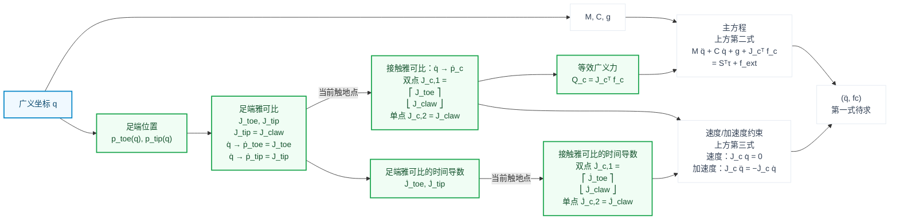
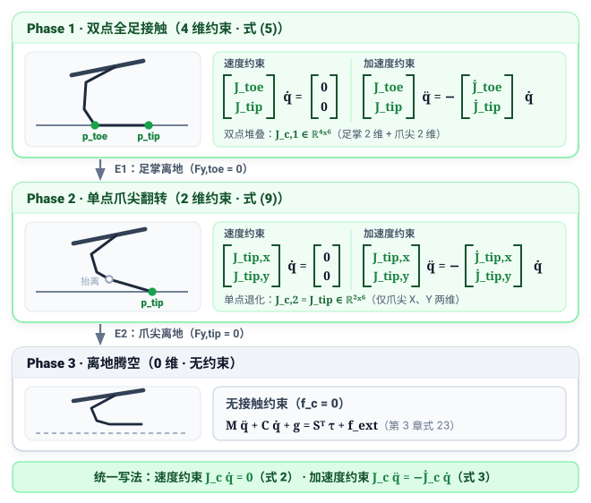

> 返回总目录：[paper_spec.md](../paper_spec.md) | 上一章：[第 0 章](00_读法与符号速查.md) | 下一章：[第 2 章](02_执行机构与非接触外力建模.md)

# 1. 浮基运动学（阶段目标 1）

$$
\underbrace{\mathbf{x}=\begin{bmatrix}\textcolor{#0284c7}{\mathbf{q}}\\ \dot{\mathbf{q}}\end{bmatrix}}_{\text{状态（已知）}},\;
\underbrace{\boldsymbol{\tau},\,\mathbf{f}_{\text{ext}}}_{\text{输入}},\;
\sigma
\;\xrightarrow{\;\text{主方程 + 加速度约束}\;}
\underbrace{\ddot{\mathbf{q}}}_{\text{待求}}
\bigl(\text{触地兼求 }\mathbf{f}_c\bigr)
$$

$$
\underbrace{\mathbf{M}(\textcolor{#0284c7}{\mathbf{q}})\underbrace{\ddot{\mathbf{q}}}_{\text{待求}} + \mathbf{C}(\mathbf{q},\dot{\mathbf{q}})\dot{\mathbf{q}} + \mathbf{g}(\mathbf{q}) + \textcolor{#16a34a}{\mathbf{J}_c}^T\mathbf{f}_c = \mathbf{S}^T\boldsymbol{\tau} + \mathbf{f}_{\text{ext}}}_{\text{主方程}}
$$

$$
\underbrace{\textcolor{#16a34a}{\mathbf{J}_c}\dot{\mathbf{q}}=\mathbf{0}}_{\text{速度约束}},\qquad
\underbrace{\textcolor{#16a34a}{\mathbf{J}_c}\underbrace{\ddot{\mathbf{q}}}_{\text{待求}}=-\textcolor{#16a34a}{\dot{\mathbf{J}}_c}\dot{\mathbf{q}}}_{\text{加速度约束}}
$$

- \(\textcolor{#0284c7}{\text{蓝底}}\)：本章人为定义的坐标起点（\(\mathbf{q}\)）
- \(\textcolor{#16a34a}{\text{绿底}}\)：本章由 \(\mathbf{q}\) 推导出的运动学交付量
- 白底：下游动力学求解框架（第 3 章内容，仅标明去向，本章不展开）

### 1. 浮基构型（广义坐标 \(\mathbf{q}\)，§1.1）

$$
\textcolor{#0284c7}{\mathbf{q}}=\begin{bmatrix}x_{\text{hip}}& y_{\text{hip}}& \theta_{\text{body}}& q_{\text{hip}}& q_{\text{ankle}}& q_{\text{toe}}\end{bmatrix}^T\in\mathbb{R}^6
$$

### 2. 足地接触运动学（§1.2；`kinematics.py`）

| 量 | 落点 |
|---|---|
| \(\textcolor{#16a34a}{\mathbf{p}_{\text{toe}},\mathbf{p}_{\text{tip}}}\) | 触地几何 / 模态 |
| \(\textcolor{#16a34a}{J_{\text{toe}},J_{\text{tip}}}\) | \(\dot{\mathbf{p}}=J\dot{\mathbf{q}}\) → 组装 \(\textcolor{#16a34a}{\mathbf{J}_c}\) |
| \(\textcolor{#16a34a}{\mathbf{J}_{c,1},\mathbf{J}_{c,2}}\) | \(\dot{\mathbf{p}}_c=\mathbf{J}_c\dot{\mathbf{q}}\)；约束 |
| \(\textcolor{#16a34a}{\dot{J},\dot{\mathbf{J}}_c}\) | \(-\dot{\mathbf{J}}_c\dot{\mathbf{q}}\) |
| \(\textcolor{#16a34a}{\mathbf{Q}_c}=\mathbf{J}_c^T\mathbf{f}_c\) | \(\mathbf{J}_c^T\) 虚功接口，进主方程左端（§1.2.3；力展开见 [第 3 章 §3.3.1](03_多刚体惯性与重力及接触约束建模.md#331-触地动力学与接触力项)） |

| 在本章 | 不在本章 |
|---|---|
| Step 1 运动学自检 | \(\mathbf{f}_c\) KKT、力矩阵展开与 \(\mathbf{M}/\mathbf{C}/\mathbf{g}\)（第 3 章）；\(\boldsymbol{\tau},\mathbf{f}_{\text{ext}}\)（第 2 章）；\(\sigma\)（第 5 章） |

## 目录

- [1.1 浮基构型（广义坐标 q）](#11-浮基构型广义坐标-q)
- [1.2 足地接触运动学](#12-足地接触运动学)
  - [1.2.1 足端单点运动学（位置、雅可比与导数）](#121-足端单点运动学位置雅可比与导数)
  - [1.2.2 分模态接触组装与无滑移约束（式 (2)–(3), (5), (9)）](#122-分模态接触组装与无滑移约束式-23-5-9)
  - [1.2.3 虚功接口 Q_c = J_c^T f_c（式 (10)）](#123-虚功接口-q_c--j_ct-f_c式-10)

---

## 1.1 浮基构型（广义坐标 q）

---

## 1.2 足地接触运动学

### 1.2.1 足端单点运动学（位置、雅可比与导数）

数值差分对拍见 [附录 A](appendices/附录A_雅可比矩阵权重推导.md)。

### 1.2.2 分模态接触组装与无滑移约束（式 (2)–(3), (5), (9)）

$$
\textcolor{#16a34a}{\mathbf{p}_{c,1}}=\begin{bmatrix}\mathbf{p}_{\text{toe}}\\ \mathbf{p}_{\text{tip}}\end{bmatrix},\quad
\textcolor{#16a34a}{\mathbf{J}_{c,1}}=\begin{bmatrix}J_{\text{toe}}\\ J_{\text{tip}}\end{bmatrix}\in\mathbb{R}^{4\times 6},\quad
\textcolor{#16a34a}{\dot{\mathbf{J}}_{c,1}}=\begin{bmatrix}\dot{J}_{\text{toe}}\\ \dot{J}_{\text{tip}}\end{bmatrix}
$$

$$
\textcolor{#16a34a}{\mathbf{p}_{c,2}}=\mathbf{p}_{\text{tip}},\quad
\textcolor{#16a34a}{\mathbf{J}_{c,2}}=J_{\text{tip}}\in\mathbb{R}^{2\times 6},\quad
\textcolor{#16a34a}{\dot{\mathbf{J}}_{c,2}}=\dot{J}_{\text{tip}}
$$

$$
\dot{\mathbf{p}}_c=\textcolor{#16a34a}{\mathbf{J}_c}\dot{\mathbf{q}}=\mathbf{0}
\quad\text{（初值投影 / 碰撞重置 / Baumgarte）}
$$

$$
\textcolor{#16a34a}{\mathbf{J}_c}\ddot{\mathbf{q}}=-\textcolor{#16a34a}{\dot{\mathbf{J}}_c}\dot{\mathbf{q}}
\quad\xrightarrow{\text{KKT（第 3 章）}}\ (\ddot{\mathbf{q}},\mathbf{f}_c)
$$

### 1.2.3 虚功接口 Q_c = J_c^T f_c（式 (10)）

$$
\mathbf{f}_c^T\dot{\mathbf{p}}_c=\mathbf{Q}_c^T\dot{\mathbf{q}},\quad
\dot{\mathbf{p}}_c=\mathbf{J}_c\dot{\mathbf{q}}
\implies
\textcolor{#16a34a}{\mathbf{Q}_c}=\textcolor{#16a34a}{\mathbf{J}_c}^T\mathbf{f}_c
$$

（简化中心 \(O_B\)：\(\mathbf{Q}_c\) 前二维主矢、第三维俯仰主矩、后三维为 \(J_1/J_2/J_4\) 关节力矩。Phase 1 / Phase 2 显式力展开与 KKT 求解见 [第 3 章 §3.3.1](03_多刚体惯性与重力及接触约束建模.md#331-触地动力学与接触力项)，模态切换 E1–E3 见 [第 5 章](05_接触模态切换与碰撞重置.md)。）
