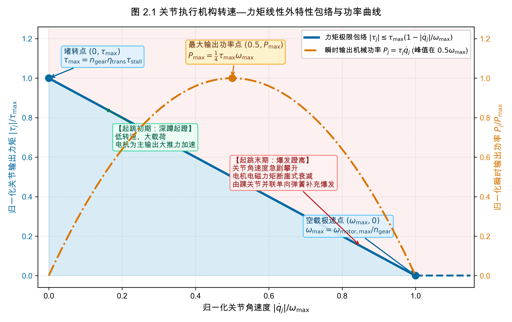
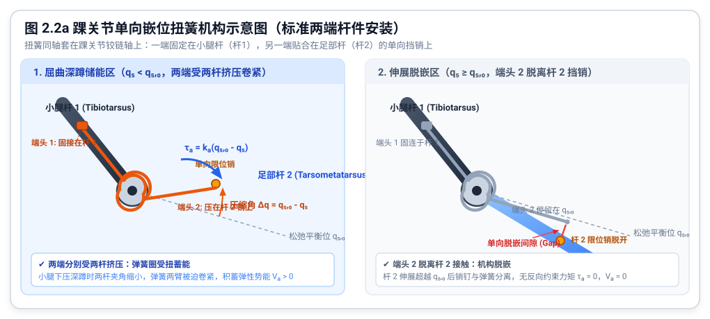
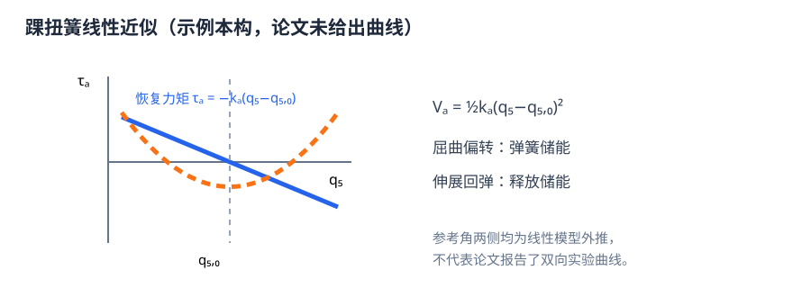
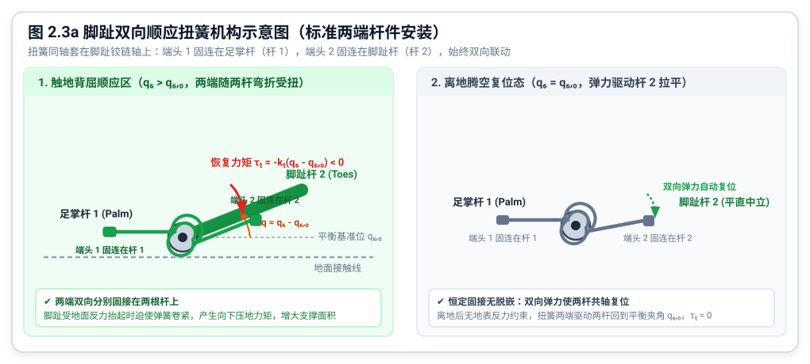
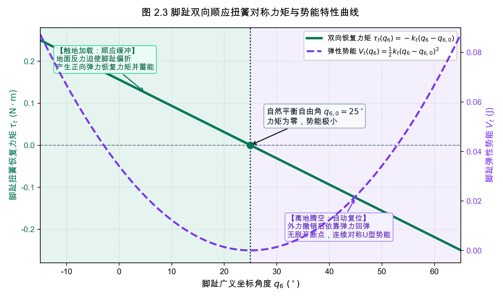
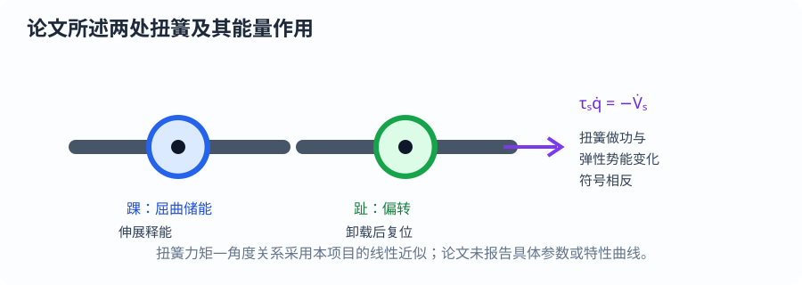
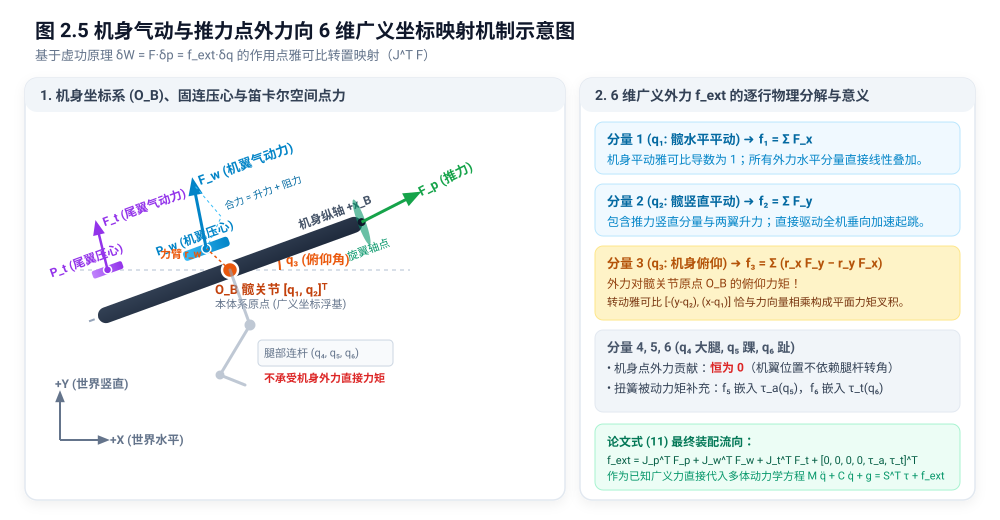

> 返回总目录：[paper_spec.md](../paper_spec.md) | 上一章：[第 1 章](01_运动学建模.md) | 下一章：[第 3 章](03_多刚体惯性与重力及接触约束建模.md)

# 2. 全机非接触广义力源总成

## 本章核心产出

本章严格针对跳跃起飞受约束动力学主方程的**等号右端项（Right-Hand Side, RHS）**进行建模，提供物理引擎求解所需的全部主动驱动力矩与被动广义外力：

$$
\mathbf{M}(\mathbf{q})\ddot{\mathbf{q}} + \mathbf{C}(\mathbf{q},\dot{\mathbf{q}})\dot{\mathbf{q}} + \mathbf{g}(\mathbf{q}) + \mathbf{J}_c^T(\mathbf{q})\mathbf{f}_c = \underbrace{\mathbf{S}^T\boldsymbol{\tau} + \mathbf{f}_{\text{ext}}}_{\mathbf{F}_{\text{right}}\text{（本章建立的全部力源）}}
$$

### 1. 全机广义力源完整分量展开式

将驱动矩阵映射 \(\mathbf{S}^T\boldsymbol{\tau}\) 与论文式 (11) 非接触外力 \(\mathbf{f}_{\text{ext}}\) 沿 6 个广义坐标 \(\mathbf{q} = [q_1, q_2, q_3, q_4, q_5, q_6]^T\) 进行分量展开，系统右端项为 \(\mathbf{F}_{\text{right}} \in \mathbb{R}^6\)。

> [!NOTE] 广义力源简化中心与各分量界定
> 组装后的 6 维广义外力向量按浮基与关节分层界定简化中心：
> * **第 1、2 分量（平动主矢）**：将全机非接触外力系向简化中心——机身本体系原点（髋轴原点 \(O_B \equiv J_1\)，**绝不是机身质心**）简化后，作用线过 \(O_B\) 的平动合力（主矢，其大小与方向不随简化中心改变）；
> * **第 3 分量（俯仰主矩）**：全机非接触外力系对同一简化中心 \(O_B\) 的俯仰外力矩（主矩），与前两维共同构成以 \(O_B\) 为简化中心的平面力旋量，保证与平动广义坐标的拉格朗日一致性；
> * **第 4、5、6 分量（关节力矩）**：分别以髋关节铰心 \(J_1\)、踝关节铰心 \(J_2\)（扭簧脱嵌平衡角 \(q_{5,0} = 145^\circ\)）、趾关节铰心 \(J_4\)（扭簧复位平衡角 \(q_{6,0} = 25^\circ\)）为简化中心与平衡角基准的关节主被动驱动力矩。

显式解析展开结构如下：

$$
\mathbf{F}_{\text{right}} = \begin{bmatrix}
F_{\text{right}, 1} \\
F_{\text{right}, 2} \\
F_{\text{right}, 3} \\
F_{\text{right}, 4} \\
F_{\text{right}, 5} \\
F_{\text{right}, 6}
\end{bmatrix} = \underbrace{\begin{bmatrix}
0 \\
0 \\
0 \\
\tau_{\text{hip}} \\
\tau_{\text{ankle}} \\
0
\end{bmatrix}}_{\mathbf{S}^T\boldsymbol{\tau}\text{（电机主动驱动）}} + \underbrace{\begin{bmatrix}
F_{p,x} + F_{w,x} + F_{t,x} \\
F_{p,y} + F_{w,y} + F_{t,y} \\
M_{p,O} + M_{w,O} + M_{t,O} \\
0 \\
\tau_a(q_5) \\
\tau_t(q_6)
\end{bmatrix}}_{\mathbf{f}_{\text{ext}}\text{（非接触外力，论文式 11）}} = \begin{bmatrix}
F_{p,x} + F_{w,x} + F_{t,x} \\
F_{p,y} + F_{w,y} + F_{t,y} \\
M_{p,O} + M_{w,O} + M_{t,O} \\
\tau_{\text{hip}} \\
\tau_{\text{ankle}} + \tau_a(q_5) \\
\tau_t(q_6)
\end{bmatrix}
$$

---

### 2. 工程实施与交付边界

* **完成标志**：在 `src/actuators.py` 中实现电机外特性限幅、扭簧力矩与势能计算，通过 `tests/test_step2.py` 的弹簧力矩—势能一致性及堵转/空载边界检验并输出特性曲线（具体验收阈值见 `plan/milestone.md` Step 2）。
* **不在本章范围**：减速比数值反解（见 [第 7 章](07_起跳仿真与减速比反解.md)）、惯性矩阵与动力学组装（见 [第 3 章](03_多刚体惯性与重力及接触约束建模.md)）、气动升阻力系数气动本构计算。

## 目录

- [2.1 关节主动驱动力矩建模](#21-关节主动驱动力矩建模)
  - [2.1.1 关节侧转速—力矩硬限幅包络](#211-关节侧转速力矩硬限幅包络)
  - [2.1.2 欠驱动选择矩阵与主动驱动映射](#212-欠驱动选择矩阵与主动驱动映射)
- [2.2 关节被动弹性力矩建模](#22-关节被动弹性力矩建模)
  - [2.2.1 踝关节单向储能弹性力矩与脱嵌本构](#221-踝关节单向储能弹性力矩与脱嵌本构)
  - [2.2.2 趾关节双向被动恢复弹性力矩本构](#222-趾关节双向被动恢复弹性力矩本构)
  - [2.2.3 弹性保守力势能负梯度与功—能自洽性](#223-弹性保守力势能负梯度与功能自洽性)
- [2.3 机身推进推力与气动外力建模](#23-机身推进推力与气动外力建模)
  - [2.3.1 空间集中点力向广义力的虚功原理映射法则](#231-空间集中点力向广义力的虚功原理映射法则)
  - [2.3.2 压心位置与点雅可比矩阵推导](#232-压心位置与点雅可比矩阵推导)
  - [2.3.3 广义力映射显式展开与力矩直觉](#233-广义力映射显式展开与力矩直觉)
  - [2.3.4 全机非接触外力向量装配（论文式 (11)）](#234-全机非接触外力向量装配论文式-11)

---

## 2.1 关节主动驱动力矩建模

### 2.1.1 关节侧转速—力矩硬限幅包络

转速—力矩包络（Torque-Speed Envelope）定义了关节执行机构在不同瞬时角速度下所能输出的最大有效力矩边界，并围合出允许正常工作的可行区间（Operating Region）。无刷直流电机转速升高时，反电动势（Back-EMF）抵消端电压，使有效电枢电流下降，可用电磁力矩因此随角速度线性衰减。

髋、踝两关节采用**同型号电机独立驱动**（每腿各配 2 个独立电机，整机共 4 个；出处见正文 p.3、p.12、p.18；统一读取 YAML `actuators.leg_motor` 中的同型参数）。传动链为：电机 → 行星齿轮箱（\(n_{\text{gear}}\)，`actuators.gearbox.ratio`）→（仅踝）1:1 同步带 → 关节，损耗统一并入 \(\eta_{\text{trans}}\)。转速—力矩映射与限幅一律在**关节侧**完成。

**1. 传动折算方程（电机轴到关节侧）**

$$
\dot{q}_j=\frac{\omega_{\text{motor},j}}{n_{\text{gear}}},\qquad
\tau_j=n_{\text{gear}}\,\eta_{\text{trans}}\,\tau_{\text{motor},j}
$$

* **物理含义**：描述电机转子运动经行星齿轮箱与同步带减速增扭后，折算到连杆关节侧的运动学与静力学传递关系。
* **式中各项注释**：
  * \(\dot{q}_j\)：第 \(j\) 关节的实际运动角速度（单位：\(\text{rad/s}\)）；
  * \(\omega_{\text{motor},j}\)：驱动第 \(j\) 关节电机的轴端瞬时转速（单位：\(\text{rad/s}\)）；
  * \(n_{\text{gear}}\)：行星齿轮箱总传动减速比（作为动力学设计变量由第 7 章起跳仿真反解确定，读取自 YAML `actuators.gearbox.ratio`）；
  * \(\tau_j\)：经机械传动放大后、实际施加在连杆关节轴上的有效驱动力矩（单位：\(\text{N}\cdot\text{m}\)）；
  * \(\eta_{\text{trans}}\)：传动链总机械效率（无量纲，综合计入齿轮啮合摩擦与踝关节 1:1 同步带损耗）；
  * \(\tau_{\text{motor},j}\)：电机转子输出的原始电磁力矩（单位：\(\text{N}\cdot\text{m}\)）。

**2. 关节侧极限特性参数（包络线的两轴截距）**

$$
\tau_{\max}=n_{\text{gear}}\,\eta_{\text{trans}}\,\tau_{\text{motor,stall}},\qquad
\omega_{\max}=\frac{\omega_{\text{motor},\max}}{n_{\text{gear}}}
$$

* **物理含义**：定义了转速—力矩坐标系中的两个物理极限截距，是界定电机能力边界的关键定值。
* **式中各项注释**：
  * \(\tau_{\max}\)：**关节侧最大堵转力矩**（包络线的纵轴截距，即关节静止 \(\dot{q}_j = 0\) 时的极限爆发扭矩）；
  * \(\tau_{\text{motor,stall}}\)：电机本体固有的堵转电磁力矩（单位：\(\text{N}\cdot\text{m}\)）；
  * \(\omega_{\max}\)：**关节侧极限空载角速度**（包络线的横轴截距，即可用力矩衰减为 0 时的转速天花板）；
  * \(\omega_{\text{motor},\max}\)：电机本体最高空载转速（由供电母线电压与电机 \(KV\) 值决定，单位：\(\text{rad/s}\)）。

**3. 关节侧转速—力矩线性包络限幅判据**

$$
\lvert\tau_j\rvert\le\tau_{\max}\max\left(0,\ 1-\frac{\lvert\dot{q}_j\rvert}{\omega_{\max}}\right),\qquad j=4,5
$$

* **物理含义**：上层控制器（如逆动力学求解器）指令力矩的硬性饱和截断准则，防止电机输出违反反电动势物理规律的“虚假推力”。
* **式中各项注释**：
  * \(\lvert\tau_j\rvert\)：控制器允许输出的实际关节驱动力矩绝对值；
  * \(1 - \frac{\lvert\dot{q}_j\rvert}{\omega_{\max}}\)：无刷电机因反电动势（Back-EMF）抵抗供电电压导致的电磁力矩线性衰减系数；
  * \(\max(0,\ \dots)\)：非负物理截断算子（当关节速度达到或超过极限空载速度 \(\lvert\dot{q}_j\rvert \ge \omega_{\max}\) 时，电机无法再产生正向力矩，输出强制归零）；
  * \(j=4,5\)：受控的主动驱动关节下标（\(j=4\) 为髋关节俯仰，\(j=5\) 为踝关节俯仰）。

图 2.1 中，蓝色实线表示关节输出力矩绝对值的物理硬上限，蓝色浅色阴影区表示允许正常工作的可行域，红色阴影区表示超出驱动能力的不可行饱和区。多体动力学正向求解时，上层控制器逆解出的命令力矩若超出该边界，必须执行硬饱和限幅，避免动力学仿真产生超越硬件反电动势极限的非物理力矩。

### 2.1.2 欠驱动选择矩阵与主动驱动映射

**结论.** 仅髋、踝两关节有电机，其余四个广义坐标无直接驱动：

$$
\mathbf{S}=\begin{bmatrix}
0 & 0 & 0 & 1 & 0 & 0 \\
0 & 0 & 0 & 0 & 1 & 0
\end{bmatrix},\qquad
\mathbf{S}^T\boldsymbol{\tau}=\begin{bmatrix}0\\0\\0\\\tau_4\\\tau_5\\0\end{bmatrix}
$$

**推导.** 式 (10)（p.14）/ (23)（p.16）把可命令力矩与 \(\mathbf{f}_{\text{ext}}\) 分列；[第 4 章](04_多任务优先级控制与力矩逆解.md) 反解 \(\boldsymbol{\tau}\)。

---

## 2.2 关节被动弹性力矩建模

踝关节储能扭簧力矩 \(\tau_a\) 与脚趾被动复位扭簧力矩 \(\tau_t\) 分别作为第 5 与第 6 分量嵌入广义非接触外力向量 \(\mathbf{f}_{\text{ext}}\)。两者均采用满足保守力负梯度关系的线性扭簧本构近似。

### 2.2.1 踝关节单向储能弹性力矩与脱嵌本构

踝关节内嵌扭簧与电机并联工作，在屈曲深蹲时储存弹性势能，在蹬伸时释放能量。模型近似为围绕参考角 \(q_{5,0}\) 工作的单向线性扭簧：

$$
\tau_a(q_5) = \begin{cases} -k_a (q_5 - q_{5,0}), & q_5 < q_{5,0} \\ 0, & q_5 \ge q_{5,0} \end{cases}
$$

$$
V_a(q_5) = \begin{cases} \tfrac{1}{2} k_a (q_5 - q_{5,0})^2, & q_5 < q_{5,0} \\ 0, & q_5 \ge q_{5,0} \end{cases}
$$

* **物理含义**：满足保守力负梯度关系 \(\tau_a = -\frac{\partial V_a}{\partial q_5}\)。仅在深蹲屈曲区间（\(q_5 < q_{5,0}\)）提供正向伸展恢复力矩；当伸展至参考角（\(q_5 \ge q_{5,0}\)）单向脱嵌后，力矩与弹性势能降为零。
* **式中各项注释**：
  * \(\tau_a(q_5)\)：踝关节扭簧在关节侧产生的被动力矩（单位：\(\text{N}\cdot\text{m}\)）；
  * \(q_5\)：广义坐标中的踝关节相对运动角（单位：\(\text{rad}\)）；
  * \(q_{5,0}\)：踝扭簧参考角（单位：\(\text{rad}\)，对应 YAML `simulation.initial.ankle_deg` 换算值 \(145^\circ\)）；
  * \(k_a\)：踝关节扭簧刚度系数（单位：\(\text{N}\cdot\text{m/rad}\)，由 YAML `simulation.spring.ankle_constant_Nmm_per_deg` 经单位换算得到）；
  * \(V_a(q_5)\)：踝关节扭簧中储存的瞬时弹性势能（单位：\(\text{J}\)）。

### 2.2.2 趾关节双向被动恢复弹性力矩本构

脚趾关节（\(q_6\)）无主动电机驱动，由双向复位扭簧提供弹性恢复力矩，模型近似为围绕自然松弛角 \(q_{6,0}\) 的线性扭簧：

$$
\tau_t(q_6) = -k_t (q_6 - q_{6,0}),\qquad
V_t(q_6) = \tfrac{1}{2} k_t (q_6 - q_{6,0})^2
$$

* **物理含义**：满足保守力负梯度关系 \(\tau_t = -\frac{\partial V_t}{\partial q_6}\)，在脚趾受地表反力发生偏转后被动提供回弹复位力矩。
* **式中各项注释**：
  * \(\tau_t(q_6)\)：脚趾扭簧在关节侧产生的被动恢复力矩（单位：\(\text{N}\cdot\text{m}\)）；
  * \(q_6\)：广义坐标中的脚趾相对偏转角（单位：\(\text{rad}\)）；
  * \(q_{6,0}\)：脚趾扭簧的自然松弛自由角（单位：\(\text{rad}\)，对应 YAML `simulation.initial.toe_deflection_deg` 换算值 \(25^\circ\)）；
  * \(k_t\)：脚趾扭簧刚度系数（单位：\(\text{N}\cdot\text{m/rad}\)，由 YAML `simulation.spring.toe_constant_Nmm_per_deg` 经单位换算得到）；
  * \(V_t(q_6)\)：脚趾扭簧中储存的瞬时弹性势能（单位：\(\text{J}\)）。

### 2.2.3 弹性保守力势能负梯度与功—能自洽性

踝关节扭簧力矩 \(\tau_a\) 与脚趾扭簧力矩 \(\tau_t\) 满足保守力负梯度关系 \(\tau = -\frac{\partial V}{\partial q}\)。在无外界能量耗散的保守状态下，扭簧广义力输出的瞬时功率严格等于弹性势能的减少率：

$$
P_{\text{spring}} = \tau_a\dot{q}_5 + \tau_t\dot{q}_6 = -\frac{\mathrm{d}}{\mathrm{d}t}\bigl(V_a + V_t\bigr)
$$

在任意时间区间 \([t_0, t_1]\) 内，扭簧恢复力矩所做的机械功严格等于势能增量的负值：

$$
\int_{t_0}^{t_1}\bigl(\tau_a\dot{q}_5+\tau_t\dot{q}_6\bigr)\,\mathrm{d}t = -\Delta V_a - \Delta V_t
$$

该功—能闭环转化关系作为 `tests/test_step2.py` 中扭簧数值做功与解析势能一致性的强制验收判据。

---

## 2.3 机身推进推力与气动外力建模

### 2.3.1 空间集中点力向广义力的虚功原理映射法则

在平面多体系统中，螺旋桨推力、机翼与尾翼气动力是作用在机身特定空间点上的二维笛卡尔矢量力 \(\mathbf{F} = [F_x, F_y]^T\)。为了将其输入到与 6 维广义加速度 \(\ddot{\mathbf{q}}\) 共轭的动力学方程右端项中，必须将其转换为 6 维广义外力向量 \(\mathbf{f} \in \mathbb{R}^6\)。

连接物理集中力与广义多体动力学的桥梁是**虚功原理（Principle of Virtual Work）**：
任一集中外力 \(\mathbf{F}\) 在空间虚拟位移 \(\delta \mathbf{p}\) 上所做的机械虚功，严格等于其等效广义力 \(\mathbf{f}\) 在广义坐标虚拟位移 \(\delta \mathbf{q}\) 上所做的虚功：

$$
\delta W = \mathbf{F} \cdot \delta \mathbf{p} = \mathbf{f} \cdot \delta \mathbf{q}
$$

空间点的虚拟位移由该点运动学速度雅可比矩阵（Jacobian）线性给出：\(\delta \mathbf{p} = \mathbf{J}(\mathbf{q}) \delta \mathbf{q}\)，代入可得：

$$
\delta W = \mathbf{F}^T (\mathbf{J} \delta \mathbf{q}) = (\mathbf{J}^T \mathbf{F})^T \delta \mathbf{q} = \mathbf{f}^T \delta \mathbf{q}
$$

由此导出笛卡尔物理外力向多刚体动力学广义力的严格映射法则：  
**点力映射为广义力，严格等于该点运动学雅可比矩阵的转置乘以物理外力向量**：

$$
\mathbf{f} = \mathbf{J}^T(\mathbf{q})\,\mathbf{F}
$$

---

### 2.3.2 压心位置与点雅可比矩阵推导

机翼与尾翼产生的空气动力（升力与阻力），其合力作用在各自的气动压心（Center of Pressure, CoP）上；螺旋桨产生的拉力作用在前置旋翼安装轴点上。在平面多体模型中，这些作用点均固连于机身刚体上。

**1. 固连点在世界坐标系下的绝对位置**

设某一固连点（机翼压心 \(w\)、尾翼压心 \(t\) 或螺旋桨安装点 \(p\)）在机身本体系（原点 \(O_B\) 为髋关节）下的局部固定坐标为 \(\mathbf{P}_{*/B} = [P_x, P_y]^T\)（读取自 YAML `simulation.reference_points`，注意 YAML 键名 `_z` 对应本文竖直分量 \(P_y\)）。

根据刚体平动与转动的坐标变换，该点在世界坐标系中的瞬时空间位置 \(\mathbf{p} = [x, y]^T\) 为：

$$
\mathbf{p}(\mathbf{q}) = \begin{bmatrix} q_1 \\ q_2 \end{bmatrix} + R(q_3) \begin{bmatrix} P_x \\ P_y \end{bmatrix} = \begin{bmatrix} q_1 + P_x \cos q_3 - P_y \sin q_3 \\ q_2 + P_x \sin q_3 + P_y \cos q_3 \end{bmatrix}
$$

* **式中各项注释**：
  * \([q_1, q_2]^T\)：机身髋关节原点 \(O_B\) 在世界系中的瞬时水平与竖直平动位置；
  * \(q_3\)：机身纵轴相对于世界水平轴的俯仰姿态角（抬头为正）；
  * \(R(q_3) = \begin{bmatrix} \cos q_3 & -\sin q_3 \\ \sin q_3 & \cos q_3 \end{bmatrix}\)：机身本体到世界坐标系的二维旋转变换矩阵。

> **直观理解**：该点的绝对位置只取决于机身整体移到了哪里（\(q_1, q_2\)）以及机身旋转了多少度（\(q_3\)）。腿部各个关节（\(q_4, q_5, q_6\)）在大腿、下肢或脚趾处无论怎样屈伸折叠，机翼和尾翼牢牢长在机身上，绝不会因为小腿摆动而改变其空间位置。因此，位置函数 \(\mathbf{p}(\mathbf{q})\) 对腿部关节角 \(q_4, q_5, q_6\) 的偏导数恒为 0。

**2. 作用点速度与雅可比矩阵求导**

对空间位置 \(\mathbf{p}(\mathbf{q})\) 关于时间求导，利用链式法则可得该点的绝对线速度 \(\dot{\mathbf{p}}\)：

$$
\dot{\mathbf{p}} = \frac{\partial \mathbf{p}}{\partial \mathbf{q}}\,\dot{\mathbf{q}} = \mathbf{J}(\mathbf{q})\,\dot{\mathbf{q}}
$$

逐项对 6 个广义速度 \(\dot{\mathbf{q}} = [\dot{q}_1, \dot{q}_2, \dot{q}_3, \dot{q}_4, \dot{q}_5, \dot{q}_6]^T\) 求偏导数：

* 对机身水平平动 \(\dot{q}_1\)：\(\frac{\partial x}{\partial q_1} = 1\)，\(\frac{\partial y}{\partial q_1} = 0\)；
* 对机身竖直平动 \(\dot{q}_2\)：\(\frac{\partial x}{\partial q_2} = 0\)，\(\frac{\partial y}{\partial q_2} = 1\)；
* 对机身俯仰旋转 \(\dot{q}_3\)：

$$
\begin{aligned}
\frac{\partial x}{\partial q_3} &= -P_x \sin q_3 - P_y \cos q_3 = -(y - q_2) \\
\frac{\partial y}{\partial q_3} &= P_x \cos q_3 - P_y \sin q_3 = (x - q_1)
\end{aligned}
$$

* 对腿部各关节 \(\dot{q}_4, \dot{q}_5, \dot{q}_6\)：机翼固连于机身，导数全为 0。

整理即得固连于机身上的点雅可比矩阵 \(\mathbf{J} \in \mathbb{R}^{2 \times 6}\)：

$$
\mathbf{J}(\mathbf{q}) = \begin{bmatrix}
1 & 0 & -(y - q_2) & 0 & 0 & 0 \\
0 & 1 & (x - q_1) & 0 & 0 & 0
\end{bmatrix}
$$

* **几何物理含义**：
  * **第 1、2 列** \([1, 0]^T\) 与 \([0, 1]^T\)：表示机身整体平移时，压心具有与机身髋点完全相同、1:1 同步的平动线速度；
  * **第 3 列** \([-(y - q_2), (x - q_1)]^T\)：表示机身以角速度 \(\dot{q}_3\) 绕髋关节转动时，由转动线速度公式 \(\mathbf{v} = \boldsymbol{\omega} \times \mathbf{r}\) 在矢状面内引起的切向圆周速度分量（其中 \(\mathbf{r} = [x - q_1, y - q_2]^T\) 即为从髋关节指向该点的向径力臂）；
  * **第 4、5、6 列**：均为零，反映腿部连杆的相对旋转对固连在机身上的压心没有任何速度传递效应。

---

### 2.3.3 广义力映射显式展开与力矩直觉

根据前述虚功原理，当该点受到世界系下的外力向量 \(\mathbf{F} = [F_x, F_y]^T\) 作用时，映射到广义坐标空间的广义力向量 \(\mathbf{f} \in \mathbb{R}^6\) 为：

$$
\mathbf{f} = \mathbf{J}^T(\mathbf{q})\,\mathbf{F} = \begin{bmatrix}
1 & 0 \\
0 & 1 \\
-(y - q_2) & (x - q_1) \\
0 & 0 \\
0 & 0 \\
0 & 0
\end{bmatrix} \begin{bmatrix} F_x \\ F_y \end{bmatrix} = \begin{bmatrix}
F_x \\
F_y \\
(x - q_1) F_y - (y - q_2) F_x \\
0 \\
0 \\
0
\end{bmatrix}
$$

展开后的每一行具有极为直观的物理意义：

1. **第 1 分量** \(f_1 = F_x\)：外力的水平分量，直接驱动机身沿水平方向平动加速（对应广义坐标 \(q_1 \equiv x_{\text{hip}}\)）；
2. **第 2 分量** \(f_2 = F_y\)：外力的竖直分量，直接驱动机身沿竖直方向平动加速（对应广义坐标 \(q_2 \equiv y_{\text{hip}}\)）；
3. **第 3 分量** \(f_3 = (x - q_1) F_y - (y - q_2) F_x\)：正是平面力学中经典的外力对髋关节原点 \(O_B\) 的**力矩标量**（力臂叉乘外力：\(r_x F_y - r_y F_x\)），直接驱动机身俯仰角加速度 \(\ddot{q}_3\)；
4. **第 4、5、6 分量** \(f_4 = f_5 = f_6 = 0\)：外力固连在机身上，不会通过机械连杆传递到髋/踝铰链，因此不对腿部关节施加直接驱动力矩（腿部运动只受多体惯性耦合效应间接影响）。

---

### 2.3.4 全机非接触外力向量装配（论文式 (11)）

全机非接触广义外力向量 \(\mathbf{f}_{\text{ext}} \in \mathbb{R}^6\) 统合了作用在机身上的推力、气动力以及腿部关节扭簧恢复力矩：

$$
\mathbf{f}_{\text{ext}} = \mathbf{f}_p + \mathbf{f}_w + \mathbf{f}_t + \boldsymbol{\tau}_{\text{spring}}
$$

式中 \(\mathbf{f}_p, \mathbf{f}_w, \mathbf{f}_t\) 分别为螺旋桨推力、机翼气动力、尾翼气动力经由各作用点雅可比矩阵转置映射到 6 维广义坐标后的广义力向量（\(\mathbf{J}_p^T \mathbf{F}_p, \mathbf{J}_w^T \mathbf{F}_w, \mathbf{J}_t^T \mathbf{F}_t\)）；\(\boldsymbol{\tau}_{\text{spring}} = [0, 0, 0, 0, \tau_a(q_5), \tau_t(q_6)]^T\) 为关节扭簧力矩向量。

各项具体计算规则如下：

**1. 螺旋桨推力广义力** \(\mathbf{f}_p\)：

* 螺旋桨安装于机头，推力大小 \(F_p\) 由电机油门设定（最大推力约 \(6.18\,\text{N}\)，读取自 YAML `simulation.aerodynamics.max_thrust_kg`）；
* 推力方向沿机身纵轴夹角为安装角偏移 \(\theta_p\)（读取自 YAML `simulation.aerodynamics.thrust_angle_offset_deg`），在世界坐标系中的推力矢量为：

$$
\mathbf{F}_p = \begin{bmatrix} F_p \cos(q_3 + \theta_p) \\ F_p \sin(q_3 + \theta_p) \end{bmatrix}
$$

* 螺旋桨安装点在世界系下的雅可比为 \(\mathbf{J}_p(\mathbf{q})\)，代入得 \(\mathbf{f}_p = \mathbf{J}_p^T(\mathbf{q}) \mathbf{F}_p\)。若简化模型中螺旋桨推力线直接穿过机身参考点（髋轴），则产生纯推力而无俯仰力矩臂。

**2. 机翼与尾翼气动力** \(\mathbf{f}_w,\ \mathbf{f}_t\)：

* 分别由准定常气动升阻力公式计算出世界系气动力向量 \(\mathbf{F}_w = [F_{w,x}, F_{w,y}]^T\) 与 \(\mathbf{F}_t = [F_{t,x}, F_{t,y}]^T\)；
* 由机翼压心 \(\mathbf{P}_w\) 和尾翼压心 \(\mathbf{P}_t\) 的雅可比矩阵分别映射：

$$
\mathbf{f}_w = \mathbf{J}_w^T(\mathbf{q})\,\mathbf{F}_w,\qquad \mathbf{f}_t = \mathbf{J}_t^T(\mathbf{q})\,\mathbf{F}_t
$$

**3. 全机非接触外力向量装配（论文式 (11)）**

将上述推进推力 \(\mathbf{f}_p\)、气动力 \(\mathbf{f}_w, \mathbf{f}_t\) 与 §2.2 建立的关节被动扭簧力矩 \(\boldsymbol{\tau}_{\text{spring}} = [0, 0, 0, 0, \tau_a(q_5), \tau_t(q_6)]^T\) 线性叠加，导出论文式 (11) 的完整非接触广义外力向量：

$$
\mathbf{f}_{\text{ext}} = \mathbf{f}_p + \mathbf{f}_w + \mathbf{f}_t + \boldsymbol{\tau}_{\text{spring}} = \begin{bmatrix}
F_{p,x} + F_{w,x} + F_{t,x} \\
F_{p,y} + F_{w,y} + F_{t,y} \\
M_{p,O} + M_{w,O} + M_{t,O} \\
0 \\
\tau_a(q_5) \\
\tau_t(q_6)
\end{bmatrix}
$$

* **式中各项注释**：
  * \(M_{*,O} = (x_* - q_1) F_{*,y} - (y_* - q_2) F_{*,x}\)：各气动力与推力对髋点原点 \(O_B\) 的俯仰力矩；
  * 该向量在 `src/actuators.py` 中装配输出，与 §2.1 电机驱动 \(\mathbf{S}^T\boldsymbol{\tau}\) 合并构成多刚体动力学主方程等号右端的全部输入。
