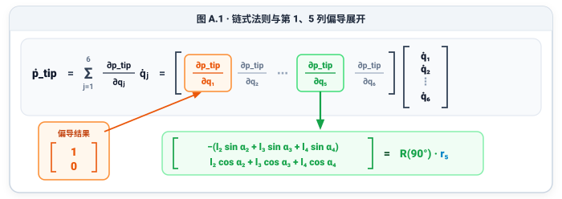
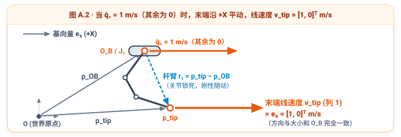
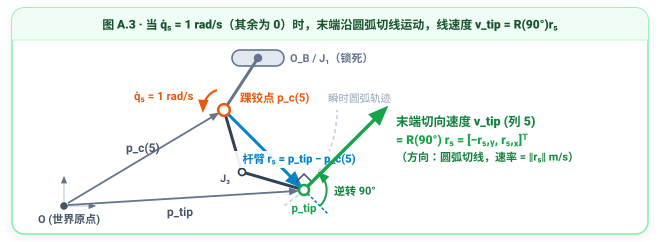
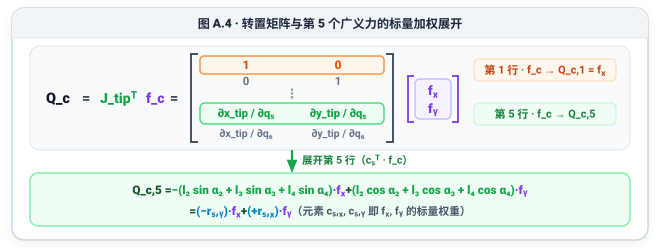
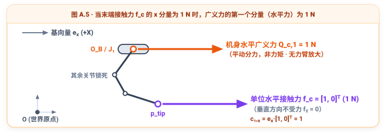
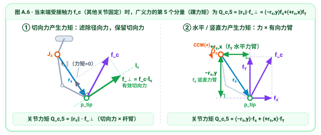

> 返回总目录：[paper_spec.md](../../paper_spec.md) | 正文对应：[第 1 章 §1.2.1](../01_运动学建模.md#121-足端单点运动学位置雅可比与导数) · [§1.2.3](../01_运动学建模.md#123-接触力向广义力映射-q_c--j_ct-f_c式-10)

# 附录 A. 足端位置对广义坐标的雅可比（J_tip / J_toe）：列向量的两重物理意义

> 本附录从**两重物理意义**出发，解释 [第 1 章 §1.2.1](../01_运动学建模.md#121-足端单点运动学位置雅可比与导数) 与 [§1.2.3](../01_运动学建模.md#123-接触力向广义力映射-q_c--j_ct-f_c式-10) 中 \(J_{\text{tip}}(\mathbf{q})\) 与 \(J_{\text{toe}}(\mathbf{q})\) 第 \(j\) 列 \(\mathbf{c}_j\) 的物理来源（极限特例验算见 [第 8 章 §8.2.1](../08_硬件设计验证与里程碑映射.md#821-step-1-雅可比极限特例验算)）。

---

## A.1 第一重物理意义：第 j 个单位广义速度在末端线速度上的贡献

第 1 列：当 \(\dot{q}_1 = 1\ \text{m/s}\)、其余广义速度分量均为 \(0\) 时，足端线速度只在世界系 \(X\) 轴上有长度为 \(1\) 的投影

第 2 列：当 \(\dot{q}_2 = 1\ \text{m/s}\)、其余广义速度分量均为 \(0\) 时，足端线速度只在世界系 \(Y\) 轴上有长度为 \(1\) 的投影

### A.1.1 平动列（j = 1, 2）：世界系基向量

$$
\textcolor{#ea580c}{\frac{\partial\mathbf{p}_{\text{tip}}}{\partial q_1}}
= \mathbf{e}_x = \begin{bmatrix} 1 \\ 0 \end{bmatrix}, \qquad
\textcolor{#ea580c}{\frac{\partial\mathbf{p}_{\text{tip}}}{\partial q_2}}
= \mathbf{e}_y = \begin{bmatrix} 0 \\ 1 \end{bmatrix},
\qquad j = 1, 2
$$

### A.1.2 转动列（j = 3, 4, 5, 6）：杆臂逆转 90°

第 3 列：当 \(\dot{q}_3 = 1\ \text{rad/s}\)、其余广义速度分量均为 \(0\) 时，足端绕 \(O_B\) 作圆周运动，线速度在杆臂逆时针切线方向上的投影长度为 \(\lVert\mathbf{r}_3\rVert\)

第 4 列：当 \(\dot{q}_4 = 1\ \text{rad/s}\)、其余广义速度分量均为 \(0\) 时，足端绕 \(J_1\equiv O_B\) 作圆周运动，线速度在杆臂逆时针切线方向上的投影长度为 \(\lVert\mathbf{r}_4\rVert\)（与第 3 列相同）

第 5 列：当 \(\dot{q}_5 = 1\ \text{rad/s}\)、其余广义速度分量均为 \(0\) 时，足端绕踝铰 \(J_2\) 作圆周运动，线速度在杆臂逆时针切线方向上的投影长度为 \(\lVert\mathbf{r}_5\rVert\)

第 6 列：当 \(\dot{q}_6 = 1\ \text{rad/s}\)、其余广义速度分量均为 \(0\) 时，足端绕趾铰 \(J_3\) 作圆周运动，线速度在杆臂逆时针切线方向上的投影长度为 \(\lVert\mathbf{r}_6\rVert\)

> **第 5 列为何只含下游杆** \(l_2 \sim l_4\)：仅改变 \(q_5\) 时，只有踝铰点 \(J_2\) 下游的 \(l_2 \sim l_4\) 会被带动（对应绝对角 \(\alpha_2 \sim \alpha_4\) 均含 \(+q_5\)，求导系数为 \(1\)）；上游大腿 \(l_1\) 静止不动（\(\alpha_1\) 不含 \(q_5\)，求导为 \(0\)），三段下游杆的矢量和即杆臂 \(\mathbf{r}_5 = \sum_{i=2}^4 [l_i\cos\alpha_i,\ l_i\sin\alpha_i]^T = \mathbf{p}_{\text{tip}} - \mathbf{p}_2\)。  
> **杆臂定义**：从第 \(j\) 个坐标对应的参考铰点 \(\mathbf{p}_{c(j)}\) 指向爪尖 \(\mathbf{p}_{\text{tip}}\) 的矢量 \(\mathbf{r}_j = \mathbf{p}_{\text{tip}} - \mathbf{p}_{c(j)}\)（\(j = 1, 2, 3, 4\) 取本体系原点 \(O_B/J_1\)；\(j = 5\) 取踝铰点 \(J_2\)；\(j = 6\) 取趾铰点 \(J_3\)）。

$$
\textcolor{#16a34a}{\frac{\partial\mathbf{p}_{\text{tip}}}{\partial q_j}}
= \mathbf{e}_z \times \textcolor{#0284c7}{\mathbf{r}_j}
= R\!\left(\tfrac{\pi}{2}\right)\textcolor{#0284c7}{\big(\mathbf{p}_{\text{tip}}-\mathbf{p}_{c(j)}\big)}
= \textcolor{#16a34a}{\begin{bmatrix} -(y_{\text{tip}}-y_{c(j)}) \\ x_{\text{tip}}-x_{c(j)} \end{bmatrix}},
\qquad j = 3, 4, 5, 6
$$

### A.1.3 全部 6 列逐列物理意义（仅令 \(\dot{q}_j = 1\)，其余为 \(0\)）

| 列 | 激活坐标 | 参考铰点 | 列向量 \(\mathbf{c}_j\) | 末端线速度物理意义 |
|---|---|---|---|---|
| 第 1 列 | \(q_1\)（机身 \(X\) 平动） | \(O_B\) | \([1,\ 0]^T\) | 沿 \(+X\) 刚性平移，速率 \(1\) |
| 第 2 列 | \(q_2\)（机身 \(Y\) 平动） | \(O_B\) | \([0,\ 1]^T\) | 沿 \(+Y\) 刚性平移，速率 \(1\) |
| 第 3 列 | \(q_3\)（机身俯仰） | \(O_B\) | \([-r_{3,y},\ r_{3,x}]^T\) | 整机绕 \(O_B\) 逆时针转，切向速率 \(\lVert\mathbf{r}_3\rVert\) |
| 第 4 列 | \(q_4\)（髋关节） | \(J_1 \equiv O_B\) | \([-r_{4,y},\ r_{4,x}]^T\) | 整腿绕 \(J_1\) 逆时针转（与第 3 列完全相同） |
| 第 5 列 | \(q_5\)（踝关节） | \(J_2\) | \([-r_{5,y},\ r_{5,x}]^T\) | 下游 \(l_2 \sim l_4\) 绕 \(J_2\) 逆时针转，切向速率 \(\lVert\mathbf{r}_5\rVert\) |
| 第 6 列 | \(q_6\)（趾关节） | \(J_3\) | \([-r_{6,y},\ r_{6,x}]^T\) | 末段 \(l_4\) 绕 \(J_3\) 逆时针转，切向速率 \(\lVert\mathbf{r}_6\rVert\) |

---

## A.2 第二重物理意义：单位水平 / 竖直接触力分别在第 j 个广义力上的贡献

将 \(\dot{\mathbf{p}}_{\text{tip}} = \sum_{j=1}^{6}\dot{q}_j\,\mathbf{c}_j\) 代入瞬时功率守恒 \(\mathbf{f}_c^T\dot{\mathbf{p}}_{\text{tip}} = \mathbf{Q}_c^T\dot{\mathbf{q}}\)，因各 \(\dot{q}_j\) 彼此独立，逐项比较系数即得：

$$
Q_{c,j} = \mathbf{c}_j^T \mathbf{f}_c = c_{j,x}\,f_x + c_{j,y}\,f_y,
\qquad
\mathbf{Q}_c = J_{\text{tip}}^T(\mathbf{q})\,\mathbf{f}_c
$$

因此，第 \(j\) 列的两个元素 \(c_{j,x},\,c_{j,y}\)，就是分别在爪尖施加单位水平力 \(\mathbf{f}_c = [1,\ 0]^T\) 与单位竖直力 \(\mathbf{f}_c = [0,\ 1]^T\) 时，在第 \(j\) 个广义力上的贡献：

- **第 1 列示例** \(\mathbf{c}_1 = [1,\ 0]^T\)（见下图 A.5）：施加单位水平接触力 \(\mathbf{f}_c = [1,\ 0]^T\ \text{N}\) 时，在机身水平平动坐标 \(q_1\) 上产生的广义力（水平分力）为 \(1\ \text{N}\)；施加单位竖直接触力 \(\mathbf{f}_c = [0,\ 1]^T\ \text{N}\) 时，在 \(q_1\) 上产生的广义力为 \(0\)。
- **第 5 列示例** \(\mathbf{c}_5 = [-r_{5,y},\ r_{5,x}]^T\)（见下图 A.6）：施加单位水平接触力 \(\mathbf{f}_c = [1,\ 0]^T\ \text{N}\) 时，对踝铰点 \(J_2\) 产生的力矩为 \(-r_{5,y}\ \text{N}\cdot\text{m}\)（竖直力臂）；施加单位竖直接触力 \(\mathbf{f}_c = [0,\ 1]^T\ \text{N}\) 时，对 \(J_2\) 产生的力矩为 \(+r_{5,x}\ \text{N}\cdot\text{m}\)（水平力臂）；若沿逆时针单位切线方向施加 \(1\ \text{N}\) 切向力，则产生最大力矩 \(\lVert\mathbf{r}_5\rVert\ \text{N}\cdot\text{m}\)。

### A.2.1 平动列（j = 1, 2）：沿世界轴的直接投影（平动分力，非力矩）

平动列 \(\mathbf{c}_1 = \mathbf{e}_x\)、\(\mathbf{c}_2 = \mathbf{e}_y\) 模长恒为 \(1\)，不涉及力臂放大，对应的广义力是**机身平动分力而非力矩**：

$$
Q_{c,1} = \mathbf{e}_x \cdot \mathbf{f}_c = f_x,
\qquad
Q_{c,2} = \mathbf{e}_y \cdot \mathbf{f}_c = f_y
$$

几何上，第 1、2 列分别把接触力 \(\mathbf{f}_c\) 正交投影到世界系 \(+X\) 与 \(+Y\) 轴，即单位接触力沿 \(+X/+Y\) 方向作用时直接等价为作用在机身平动坐标 \(q_1, q_2\) 上的水平 / 竖直分力。

### A.2.2 转动列（j = 3, 4, 5, 6）：单位接触力在对应铰点产生的力矩

转动列对应的广义力 \(Q_{c,j}\) 为**力矩**（力矩 = 力 × 力臂，**力臂**即转轴到力的作用线的垂直距离，逆时针为正；\(j=3\) 为机身俯仰力矩，\(j=4,5,6\) 为髋、踝、趾关节力矩）：

$$
Q_{c,j} = \mathbf{c}_j \cdot \mathbf{f}_c = \lVert\mathbf{r}_j\rVert\,(\mathbf{f}_c \cdot \hat{\mathbf{t}}_j) = (-r_{j,y})\,f_x + (r_{j,x})\,f_y = (\mathbf{r}_j \times \mathbf{f}_c)_z,
\qquad j = 3, 4, 5, 6
$$

- **看图 A.6 左（按杆臂 / 切线拆力）**：把接触力 \(\mathbf{f}_c\) 拆成两半——顺着杆臂指向转轴的**径向力** \(\mathbf{f}_\parallel\) 作用线穿过转轴，力臂为 \(0\)（类似顺着门板往门轴里推，推不动，力矩为 \(0\)）；垂直于杆臂的**切向力** \(f_\perp = \mathbf{f}_c\cdot\hat{\mathbf{t}}_j\)（沿 \(\mathbf{c}_j\) 的逆时针切线方向）垂直于杆臂，力臂就是整根杆臂长 \(\lVert\mathbf{r}_j\rVert\)（即 \(\lVert\mathbf{c}_j\rVert\)），所以力矩 = 切向力 × 杆臂长 = \(\lVert\mathbf{r}_j\rVert\,f_\perp\)。
- **看图 A.6 右（按水平 / 竖直拆力）**：水平力 \(f_x\) 的作用线是一条水平线，转轴到它的垂直距离就是竖直高度差 \(-r_{j,y}\)（即 \(c_{j,x}\)，单位水平力产生的力矩）；竖直力 \(f_y\) 的作用线是一条竖直线，转轴到它的垂直距离就是水平跨度 \(+r_{j,x}\)（即 \(c_{j,y}\)，单位竖直力产生的力矩）。6 个列向量的 \(x, y\) 分量横向拼成 \(J_{\text{tip}}\) 后，第 1、2 行自然成为 \(f_x, f_y\) 在 6 个坐标上的权重（双点接触中 \(J_{\text{toe}}\) 第 6 列为 \(\mathbf{0}\)，因趾关节接触力直接压在转轴 \(J_3\) 上、力臂为 \(0\)）。

### A.2.3 全部 6 列逐列物理意义（分别施加 \(\mathbf{f}_c = [1,\ 0]^T\) 与 \([0,\ 1]^T\)）

| 列 | 广义力 \(Q_{c,j}\) 物理含义 | \(\mathbf{f}_c = [1,\ 0]^T\) 贡献（\(c_{j,x}\)） | \(\mathbf{f}_c = [0,\ 1]^T\) 贡献（\(c_{j,y}\)） |
|---|---|---|---|
| 第 1 列 | 机身水平平动分力 | \(1\)（全部投影到 \(+X\)） | \(0\) |
| 第 2 列 | 机身竖直平动分力 | \(0\) | \(1\)（全部投影到 \(+Y\)） |
| 第 3 列 | 机身对 \(O_B\) 俯仰力矩 | \(-r_{3,y}\)（对 \(O_B\) 竖直力臂） | \(+r_{3,x}\)（对 \(O_B\) 水平力臂） |
| 第 4 列 | 髋关节 \(J_1\) 力矩 | \(-r_{4,y}\)（与第 3 列相同） | \(+r_{4,x}\)（与第 3 列相同） |
| 第 5 列 | 踝关节 \(J_2\) 力矩 | \(-r_{5,y}\)（对 \(J_2\) 竖直力臂） | \(+r_{5,x}\)（对 \(J_2\) 水平力臂） |
| 第 6 列 | 趾关节 \(J_3\) 力矩 | \(-r_{6,y}\)（\(J_{\text{toe}}\) 时为 \(0\)） | \(+r_{6,x}\)（\(J_{\text{toe}}\) 时为 \(0\)） |
