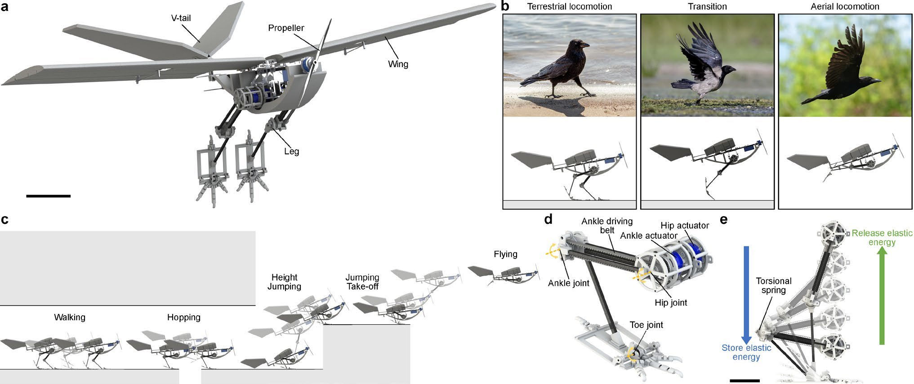
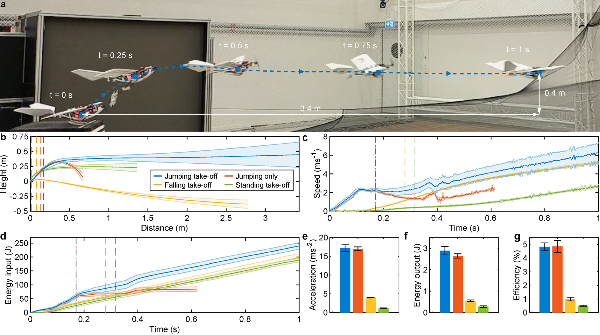
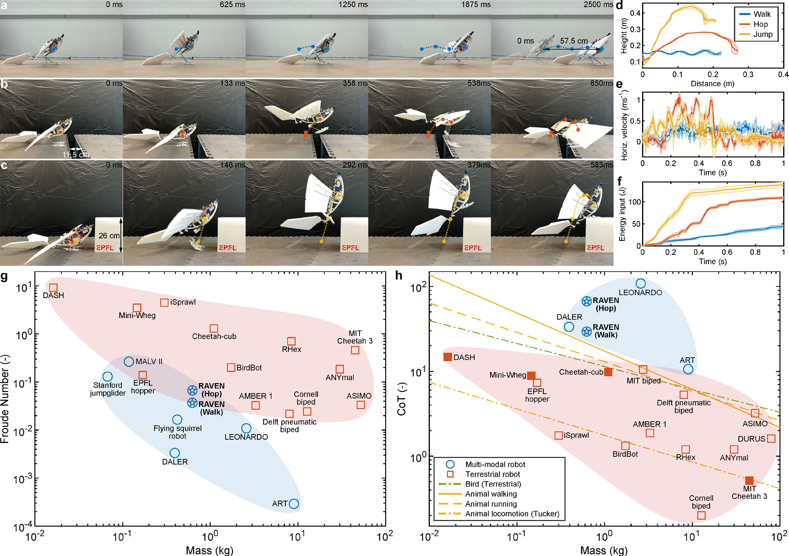
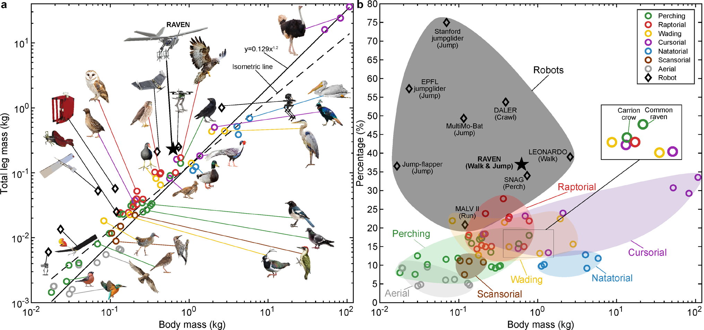
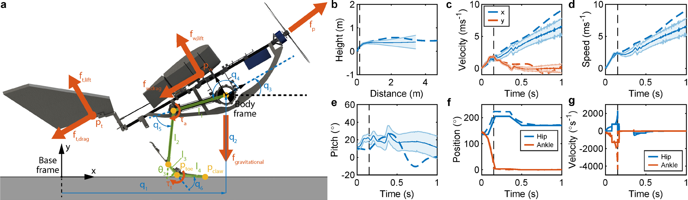
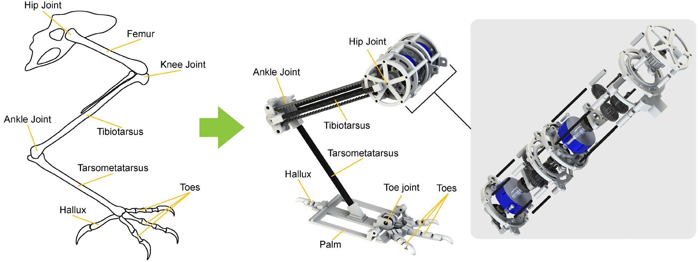
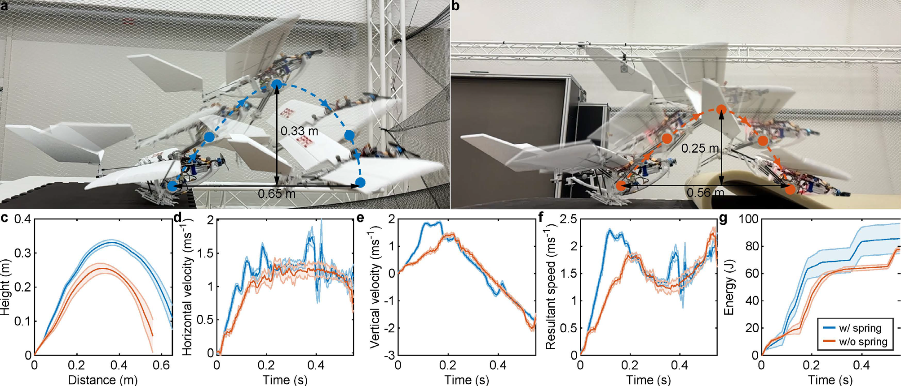
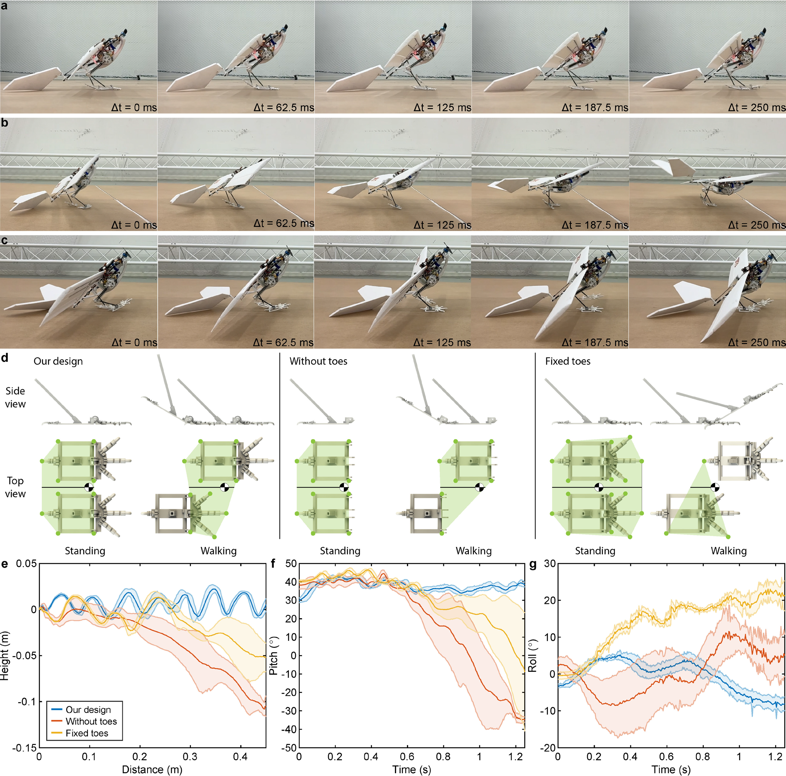
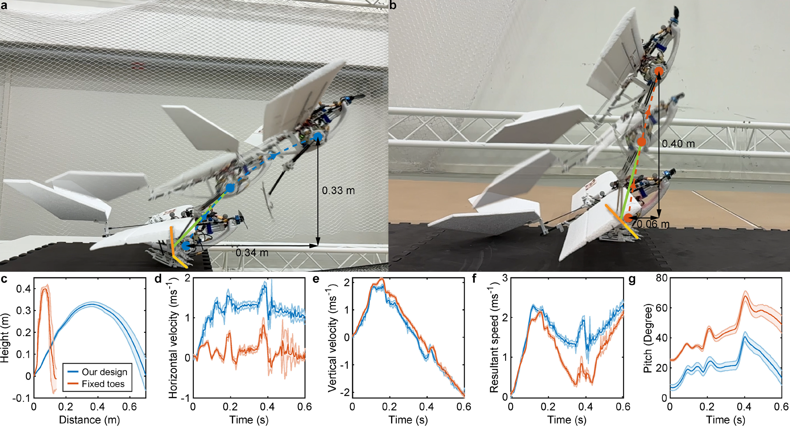
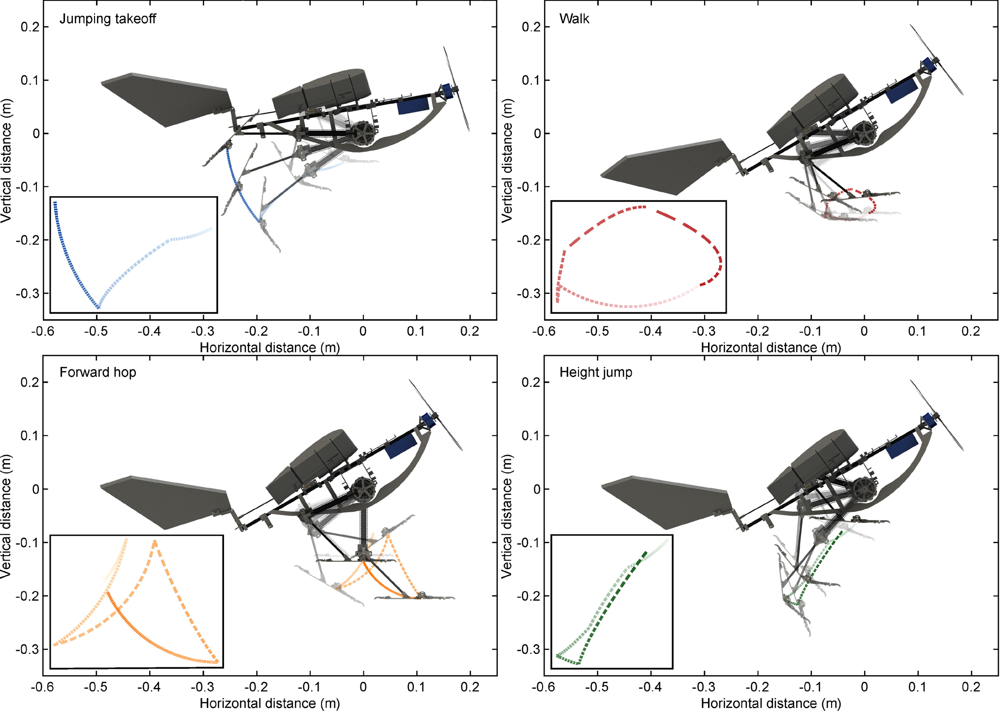

# Fast ground-to-air transition with avian-inspired multifunctional legs
## 基于鸟类多功能腿部仿生的快速空地过渡

**原文 DOI**: 10.1038/s41586-024-08228-9  
**原文链接**: [Nature 官方论文页面](https://www.nature.com/articles/s41586-024-08228-9)  
**作者**: Won Dong Shin, Hoang-Vu Phan, Monica A. Daley, Auke J. Ijspeert, Dario Floreano  
**机构**: 洛桑联邦理工学院 (EPFL)、加州大学欧文分校 (UC Irvine)

---

---

## 目录 / Table of Contents

- [Abstract / 摘要](#abstract--摘要)
- [Main text / 正文引言](#main-text--正文引言)
- [Bird-inspired biped mechanism / 仿鸟双足机构设计](#bird-inspired-biped-mechanism--仿鸟双足机构设计)
- [Jumping take-off and aerodynamic coordination / 起跳离地与气动推进协同](#jumping-take-off-and-aerodynamic-coordination--起跳离地与气动推进协同)
- [Terrestrial locomotion: walking, hopping, leaping / 地面行走、小跳与越障多模态运动](#terrestrial-locomotion-walking-hopping-leaping--地面行走小跳与越障多模态运动)
- [Leg mass budget and eco-morphological trade-offs / 腿部质量预算与生态演化权衡](#leg-mass-budget-and-eco-morphological-trade-offs--腿部质量预算与生态演化权衡)
- [Discussion / 讨论](#discussion--讨论)
- [Methods / 方法](#methods--方法)
  - [Design process / 设计流程](#design-process--设计流程)
    - [Mass and dimensions / 质量与尺寸](#mass-and-dimensions--质量与尺寸)
    - [Actuator selection / 执行机构选型](#actuator-selection--执行机构选型)
    - [Gearbox design / 齿轮箱与减速比设计](#gearbox-design--齿轮箱与减速比设计)
    - [Foot design and toe offset / 足部设计与脚趾偏置](#foot-design-and-toe-offset--足部设计与脚趾偏置)
  - [Dynamics modeling and simulation / 动力学建模与数值仿真](#dynamics-modeling-and-simulation--动力学建模与数值仿真)
    - [6-DoF planar jumping model / 平面 6 自由度起跳模型](#6-dof-planar-jumping-model--平面-6-自由度起跳模型)
    - [Non-slipping contact constraints / 足地非滑移接触约束](#non-slipping-contact-constraints--足地非滑移接触约束)
    - [Equations of motion / 多刚体动力学方程](#equations-of-motion--多刚体动力学方程)
  - [Control and Torque Resolution / 控制算法与关节力矩逆解](#control-and-torque-resolution--控制算法与关节力矩逆解)
    - [Hierarchical task-priority control / 分层任务优先级控制](#hierarchical-task-priority-control--分层任务优先级控制)
    - [QR decomposition for torque resolution / QR 分解力矩逆解](#qr-decomposition-for-torque-resolution--qr-分解力矩逆解)
    - [Aerial phase dynamics / 腾空飞行相动力学](#aerial-phase-dynamics--腾空飞行相动力学)
  - [Hardware fabrication and system integration / 硬件制作与系统集成](#hardware-fabrication-and-system-integration--硬件制作与系统集成)
    - [Chassis and leg structure / 机身底盘与腿部机械结构](#chassis-and-leg-structure--机身底盘与腿部机械结构)
    - [Propulsion and aerodynamics / 推进动力与气动翼面](#propulsion-and-aerodynamics--推进动力与气动翼面)
    - [Avionics and distributed CAN architecture / 航电与分布式 CAN 总线架构](#avionics-and-distributed-can-architecture--航电与分布式-can-总线架构)
  - [Energetics and Cost of Transport (CoT) / 能耗分析与运输成本计算](#energetics-and-cost-of-transport-cot--能耗分析与运输成本计算)
    - [Electrical and mechanical energy calculation / 电能与机械功积分](#electrical-and-mechanical-energy-calculation--电能与机械功积分)
    - [Cost of Transport / 运输成本 (CoT)](#cost-of-transport--运输成本-cot)
- [Extended Data Figures / 补充数据图表与详细图释](#extended-data-figures--补充数据图表与详细图释)
  - [Extended Data Fig. 1 | 鸟类后肢解剖学与机械腿构型对比](#extended-data-fig-1--structure-comparison-of-an-avian-leg-and-our-robotic-leg-design)
  - [Extended Data Fig. 2 | 有无踝关节储能扭簧起跳对比](#extended-data-fig-2--jumping-comparison-with-and-without-ankle-springs)
  - [Extended Data Fig. 3 | 三种足部构型行走对比](#extended-data-fig-3--walking-comparison-with-different-foot-designs)
  - [Extended Data Fig. 4 | 顺应足与刚性足跳跃对比](#extended-data-fig-4--jumping-comparison-with-different-foot-designs)
  - [Extended Data Fig. 7 | 足端规划轨迹与折叠收纳](#extended-data-fig-7--foot-trajectory-generation-and-gait-phase-decomposition)

---

### Abstract / 摘要

Most birds can navigate seamlessly between aerial and terrestrial environments. Whereas the forelimbs evolved into wings primarily for flight, the hindlimbs serve diverse functions such as walking, hopping, and leaping, and jumping take-off for transitions into flight. These capabilities have inspired engineers to aim for similar multi-modality in aerial robots, expanding their range of applications across diverse environments.
> 绝大多数鸟类能够在空中与地面环境中无缝穿梭。鸟类的前肢主要演化为适于飞行的翅膀，而其后肢则具备多样化功能，如行走、跳跃、跨越以及用于过渡到飞行阶段的起跳离地。这些非凡能力激发了工程技术人员在飞行机器人中追求类似的多模态运动特性，从而拓展其在复杂多样环境中的应用边界。

However, challenges remain in reproducing multi-modal locomotion, across gaits with distinct kinematics and propulsive characteristics, such as walking and jumping, while preserving lightweight mass for flight. This tradeoff between mechanical complexity and versatility limits most existing aerial robots to only one additional locomotor mode.
> 然而，要在保持飞行所需轻量化质量的同时，重现具有显著不同运动学与推进特性的多模态步态（例如行走与起跳），仍然面临巨大挑战。这种机械复杂度与运动多功能性之间的权衡取舍，使得目前绝大多数空中机器人仅能额外具备一种地面运动模态。

Here, we overcome the complexity-versatility tradeoff with RAVEN (Robotic Avian-inspired Vehicle for multiple ENvironments), which uses its bird-inspired multi-functional legs to jump rapidly into flight, walk on ground and hop over obstacles and gaps similar to the multi-modal locomotion of birds.
> 在此，我们通过 RAVEN（面向多种环境的鸟类仿生机器人平台）克服了复杂度与多功能性之间的权衡。RAVEN 利用其仿生多功能腿部，能够快速起跳跃入空中飞行、在地面平稳行走，并像鸟类一样跳跃跨越障碍物与沟壑，实现了类似鸟类的多模态复合运动。

We show that jumping for take-off contributes substantially to initial flight take-off speed and, remarkably, that it is more energy-efficient than solely propeller-based take-off. Our analysis suggests an important tradeoff in mass distribution between legs and body among birds adapted for different locomotor strategies, with greater investment in leg mass among terrestrial birds with multi-modal gait demands. Multi-functional robot legs expand opportunities to deploy traditional fixed-wing aircraft in complex terrains through autonomous take-offs and multi-modal gaits.
> 我们的研究表明，蹬地起跳对初始离地起飞速度具有显著贡献；尤为突出的是，这种弹射起跳方式比单纯依靠螺旋桨滑跑起飞更加节能。我们的分析进一步揭示了适应不同运动策略的鸟类在腿部与躯干质量分配上的关键权衡：对多模态步态需求更高的陆生鸟类，其腿部肌肉质量占比明显更大。多功能仿生腿部通过实现自主弹射起飞与多模态地面步态，为将传统固定翼无人机部署到复杂未知地形中提供了广阔的应用前景。

---

### Main text / 正文引言

Birds power flight using wings, but multi-segmented legs are the key skeletal feature that enables birds to navigate almost all complex terrestrial terrains and transition between domains. Birds adapt their gait kinematics to meet the demands of multiple locomotion modes through varied activation of muscles to control motion of leg and foot segments at the hip, knee, ankle, and toe joints.
> 鸟类利用翅膀提供飞行升力与动力，但多节段腿部骨骼系统才是赋能鸟类穿越几乎所有复杂陆地地形并完成空地跨域过渡的关键骨骼特征。鸟类通过多样化的肌肉激活模式，精准控制髋、膝、踝及脚趾各关节处肢体节段的协调运动，从而调整步态运动学以满足多种运动模态的严苛需求。

In addition, birds can store elastic energy in the muscle-tendon systems of the leg during flexion and release it during extension for take-off. These mechanisms allow birds not only to walk and jump to overcome gaps but also to rapidly accelerate to the velocity required for take-off. However, powerful legs come at the cost of added weight during flight, and therefore a trade-off exists in investment of muscle mass for terrestrial versus aerial locomotor modes. As discussed below, this trade-off depends on the ecological niche and the size of the bird.
> 此外，鸟类能够在腿部屈曲时将弹性势能储存至肌腱弹性系统中，并在蹬伸起跳时瞬间将其爆发释放。这些独特的生物力学机制不仅使鸟类能够行走和跳跃跨越沟壑，还能使其在极短时间内迅速加速至离地起飞所需的临界速度。然而，强健有力的腿部在空中飞行时必然会带来附加重量代价，因此在陆地运动与空中飞行的肌肉质量分配投资上存在根本性的权衡。如下文所述，这种权衡直接取决于鸟类的生态位与体型尺度。

Multi-functional legs inspired by birds may also expand the locomotion capabilities of aerial robots. For example, fixed-wing drones display higher energetic efficiency and flight endurance compared to rotary-wing drones, but are restricted in ground mobility and take-off typically requires a runway or a launcher.
> 受鸟类启发的多功能腿部设计同样能够极大拓展空中机器人的运动包线。例如，与旋翼无人机相比，固定翼无人机展现出更高的能量利用效率和更长的飞行续航时间，但其地面机动性受到极大限制，且起飞通常必须依赖平整跑道或专用发射架。

With bird-inspired legs, a winged drone could in principle walk, run, hop, and actively transition between ground and air by jumping for take-off―strategies commonly used by most birds―and thus eliminate the need for a runway or launcher regardless of terrain conditions.
> 若配备仿鸟多功能腿部，带翼无人机原则上就能实现行走、奔跑、小跳，并通过自主弹跳起飞主动完成空地过渡——这正是绝大多数鸟类普遍采用的生存策略——从而彻底摆脱对跑道或弹射装置的依赖，适应任意复杂的野外地形条件。

Developing such multi-modal aerial robots poses major challenges. First, adding more locomotion modes comes at the cost of increased mechanical complexity and mass, which may make flight inefficient or impossible. Consequently, most multi-modal aerial robots to date are limited to one additional locomotor mode or function in addition to flight.
> 研发此类多模态空中机器人面临数项重大挑战。首先，增加额外的运动模态往往以增加机械复杂度与结构质量为代价，这极易导致飞行效率骤降甚至无法起飞。因此，迄今为止绝大多数多模态飞行机器人除飞行外仅能增加一种简单的辅助运动模式。

Second, distinct gait kinematics and propulsive characteristics are required to generate distinct locomotor modes, such as walking and jumping. Walking requires a lower peak propulsive force to push the body forward in a rhythmic and continuous cycle. In contrast, jumping, especially for take-off, demands a much higher propulsive force over a short period of time to generate rapid and forceful leg extension that accelerates the body against gravity.
> 其次，实现不同的运动模态（如地面行走与弹射起跳）需要完全不同的步态运动学与推进力学特性。地面行走需要较低的峰值推进力，在节律性、连续的循环中推动身体向前移动；相比之下，起跳（特别是起飞蹬伸）则要求在极短时间内爆发极高的推进力，通过迅速且强有力的腿部快速伸展克服重力做功，将机身加速至脱离地面。

Most bio-inspired bipedal walking platforms are too bulky and heavy for integration into drones that can jump and transition to flight. Miniature robotic jumpers at the scale of small birds that rely on passive and rapid release of elastic spring mechanisms to generate jumping forces are not suitable for typical walking gaits. Although such jumpers can navigate the ground by consecutive hopping―a behavior observed in small arboreal birds―hopping at the scale of large birds incurs high energetic cost, which may explain why larger birds walk. Therefore, a new leg and foot design is required for winged drones to walk, hop, jump, and fly as birds do.
> 目前大多数仿生双足行走平台体型笨重、质量过大，无法集成到兼具起跳与飞行能力的无人机平台上。而小鸟尺度的微型跳跃机器人虽然依靠被动弹性弹簧机构的快速释放产生爆发跳跃力，却无法兼容常规的节律行走步态。尽管这类跳跃机器人可以通过连续弹跳在地面移动（这种行为见于小型树栖鸟类），但对于体型较大的鸟类尺度而言，连续跳跃会消耗极高的代谢能量，这也解释了为何大型鸟类在地面更偏好步行走动。因此，必须提出一种兼顾行走、跳跃跨越、起飞弹射与飞行的新型仿鸟腿足拓扑与机构设计。

---

### Bird-inspired biped mechanism / 仿鸟双足机构设计

> **Fig. 1 | Avian-inspired robot design and capabilities.**  
> **a**, RAVEN with a pair of legs, a pair of fixed wings, and a V-tail. RAVEN can deflect the wing ailerons and the V-tail to control flight. Scale bar, 10 cm.  
> **b**, Similar to birds, RAVEN is capable of both terrestrial and aerial locomotion and active ground-to-air transition.  
> **c**, When flying is not possible, the bipedal legs enable RAVEN to walk on the ground, hop to clear a gap, jump over an obstacle, and jump to take-off for flight.  
> **d**, The hip and ankle joints of the leg mechanism are driven by two electromagnetic motors, and the toe joint of the foot is passively compliant with an embedded torsional spring.  
> **e**, The ankle joint also has an embedded torsional spring, allowing storage and release of elastic energy during ankle flexion and extension, respectively. Scale bar, 5 cm.  
>  
> **图 1 | 仿鸟机器人构型与运动能力。**  
> **a**，配备一对机械腿、一对固定翼与 V 型尾翼的 RAVEN 机器人整机。可通过偏转副翼与 V 尾控制飞行姿态。比例尺：10 cm。  
> **b**，类似真实鸟类，RAVEN 兼具陆地运动、空中飞行以及主动空地过渡能力。  
> **c**，在无法起飞的环境下，仿生双足使机器人能够平稳步行、跳跃过沟、跃上障碍，并自主弹射起飞。  
> **d**，腿部机构的髋、踝关节由两台电机独立驱动，足部脚趾关节内嵌双向顺应扭簧实现被动顺应。  
> **e**，踝关节内嵌储能扭簧，在关节屈曲与伸展时分别实现弹性势能的储存与瞬间爆发释放。比例尺：5 cm。

Here, we present a bird-inspired biped mechanism that enables RAVEN (Robotic Avian-inspired Vehicle for multiple ENvironments) to walk, hop, jump onto an obstacle, and jump for take-off (Fig. 1a-c). Like the hindlimbs of birds, each robotic limb consists of a hip, ankle, and foot (Fig. 1d and Extended Data Fig. 1).
> 在此，我们提出了一种仿鸟双足机械结构，使 RAVEN 平台能够实现行走、小跳、跳上障碍物以及弹射起跳（图 1a-c）。与鸟类后肢类似，该机器人的每条机械腿均由髋关节、踝关节和足部三部分构成（图 1d 与补充数据图 1）。

Although birds have a more complex multi-segmented leg anatomy, replicating the full range of joints and degrees of freedom (DoFs) of a bird leg requires a high level of mechanical complexity that would substantially increase weight and control complexity. We therefore simplified the design into a two-segmented leg that rotates around a controllable hip joint connecting the leg to the body, and an ankle joint that increases the range of foot position in the sagittal plane required for generating variable leg kinematics.
> 尽管鸟类后肢具有更为复杂的多节段解剖构造，但完全复制鸟类腿部的所有生物关节和多自由度（DoF）将带来极高的机械复杂度，显著增加系统整机重量和下位控制算法的复杂性。因此，我们将腿部构型精简为两节段连杆设计：通过连接机身与腿部的受控主动髋关节旋转驱动，以及一个显著扩大足部在矢状面工作空间范围的主动踝关节，以生成灵活可变的腿部运动学曲线。

The muscle mass of the bird hindlimb is distributed mostly in the upper leg (femur) near the hip joint, thus minimizing the moment of inertia and minimizing energetic cost. To achieve a similar mass distribution, we located the driving electromagnetic actuators and gearboxes, which represent 64.5% of the leg's mass, at the hip joint (See Extended Data Table 1). We used a timing belt and pulleys to transfer the power output of the ankle actuator to the ankle joint (Fig. 1d).
> 鸟类后肢的肌肉质量绝大部分集中在靠近髋关节的大腿近端（股骨区域），这种质量高度近端化的分布极大降低了腿部转动惯量与摆动能耗。为了实现类似的仿生质量分布，我们将占整腿质量 64.5% 的电驱动执行器与行星减速齿轮箱全部集中布置在机身近髋关节位置（参见补充数据表 1），并采用轻量化同步带和同步轮将踝电机输出的动力平稳传递至远端踝关节轴心（图 1d）。

A bird prepares for a jump by flexing its legs to store elastic energy in the distal joints, including the ankle. By rapidly extending the legs from the flexed posture, the bird amplifies the peak power output by combining the energy stored in the tendon with power produced by the muscle to generate an explosive jump (Supplementary Video 1).
> 鸟类在准备起跳时，通过主动屈曲腿部将弹性势能蓄积在包含踝关节在内的远端关节腱性组织中；在从屈曲深蹲姿态迅速蹬伸的过程中，鸟类将肌腱中储存的弹性应变能与肌肉做功瞬间叠加，实现输出峰值功率的数倍级放大，完成极富爆发力的蹬地起跳（参见补充视频 1）。

We capture the principle of energy storage and rapid release by embedding a torsional spring at the ankle joint (Fig. 1e) that can boost the instantaneous power output of the ankle actuator and improve jumping speed by 25% (Extended Data Fig. 2).
> 我们借鉴了这种能量储存与快速释放的生物力学原理，在踝关节转轴处内嵌了一套储能扭转弹簧（图 1e）。该扭簧能够在蹬伸末期极大助推踝关节执行机构的瞬时机械功率输出，将起跳离地末速度显著提升了 25%（参见补充数据图 2）。

Birds control motion of the multi-jointed foot by digital flexor and extensors and motion of toe joints by the coupling of multi-articular muscles acting at the knee and ankle. To reduce mechanical and control complexity, we designed a flat foot with a back claw and a passive elastic toe joint (Fig. 1d). We located the toe joint at a distance from the rigid intersection point between foot and the leg created by the toe joint and the back claw. The toe joint includes also a torsional spring to passively comply with the ground while maintaining toe contact with the ground, thus helping to mitigate slippage and orienting the body.
> 鸟类通过足趾屈肌和伸肌调控多关节足部的精细动作，并通过跨越膝踝的多关节肌肉耦合驱动脚趾运动。为最大限度降低机械与控制复杂度，我们设计了包含后爪和被动弹性脚趾关节的平底足部构型（图 1d）。脚趾转轴距后爪和腿足交汇点具有特定偏置距离。该脚趾关节同轴嵌入了被动顺应扭簧，在脚趾紧密贴地时能够自适应地面发生顺应偏转，显著抑制足底打滑并协助调整机身俯仰姿态。

---

### Jumping take-off and aerodynamic coordination / 起跳离地与气动推进协同

> **Fig. 2 | Jumping take-off with aerodynamic thrust coordination.**  
> **a**, Time-sequential snapshots of the jumping take-off transition into flight.  
> **b–d**, Trajectory, altitude, and forward velocity profiles showing that the legs accelerate the robot to 2.2 m/s, contributing significantly to the lift-off threshold.  
> **e–g**, Propeller thrust coordination boosts total take-off velocity to 4.5 m/s, achieving an initial clearance height of 0.4 m (twice the leg length).  
> **h–i**, Comparison with falling take-off (loss of altitude) and standing take-off (insufficient speed without a runway), highlighting the energetic and kinematic superiority of jumping take-off.  
>  
> **图 2 | 弹射起跳离地与气动推力协同。**  
> **a**，弹射起飞过渡至空中飞行的连续高速时序快照。  
> **b–d**，运动轨迹、离地高度与前向速度曲线表明，仅凭机械双腿即可将机身加速至 2.2 m/s，为达到起飞升力速度提供了最核心贡献。  
> **e–g**，螺旋桨拉力协同使离地合成速度跃升至 4.5 m/s，并使飞行器在 0.4 m 的安全初始高度（两倍腿长）切入飞行相，避开地表障碍。  
> **h–i**，与高处俯冲坠落起飞（必须牺牲高度换取动能）以及地面滑跑静态起飞（无跑道无法升空）对比，凸显了弹射起跳在能量利用与运动学上的显著优势。

To achieve a successful transition from ground to air, the robot must reach the minimum flight speed during the jumping phase before the feet leave the ground. We coupled the propeller thrust with leg extension to maximize take-off performance.
> 为实现从地面到空中的成功过渡，机器人必须在双足脱离地面之前的起跳蹬伸阶段达到最低飞行速度门槛。我们将前置螺旋桨拉力与腿部强力蹬伸紧密耦合，以最大化起飞性能。

We conducted jumping tests with and without thrust from the propeller and found that the legs alone could generate a take-off speed of 2.2 m/s, contributing substantially to the total required take-off speed (Fig. 2c). When combined with the propeller thrust, the robot reached a take-off speed of 4.5 m/s at the moment of lift-off, and the jumping legs enabled the robot to start flight at a height of 0.4 m (about twice its leg length), which helps clear potential ground obstacles.
> 我们在有无螺旋桨推力两种工况下进行了起跳实验，发现仅凭双腿蹬地即可产生 2.2 m/s 的离地速度，贡献了起飞所需总速度的关键部分（图 2c）。当与螺旋桨拉力协同工作时，机器人在离地瞬间的合成速度高达 4.5 m/s，且弹射双腿赋能机器人在距地 0.4 m 的初始高度（约为其腿长的两倍）进入飞行状态，有助于避开地表障碍物。

For comparison, we tested two alternative take-off strategies: falling take-off from an elevated perching spot and standing take-off on the ground relying solely on propeller thrust. The falling take-off produced lower initial speeds of approximately 1.1 m/s and required losing altitude to convert potential energy into kinetic energy to gain flight speed. Standing take-off from the ground without jumping produced the lowest speed of about 0.4 m/s and struggled to transition into flight without a long runway.
> 作为对比，我们测试了另外两种起飞策略：从高处栖息点俯冲下落的坠落起飞（Falling take-off），以及仅依靠螺旋桨推力从平地滑跑拉起的静态起飞（Standing take-off）。坠落起飞产生的初始速度较低（约 1.1 m/s），且必须牺牲飞行高度将重力势能转化为动能才能达到飞行动压；而在地面无弹跳辅助的静态滑跑起飞仅产生约 0.4 m/s 的极低初速，在缺乏跑道时极难完成爬升过渡。

---

### Terrestrial locomotion: walking, hopping, leaping / 地面行走、小跳与越障多模态运动

> **Fig. 3 | Terrestrial locomotion: walking, hopping, and obstacle leaping.**  
> **a**, Time-sequential snapshots of continuous bipedal walking at a forward velocity of 0.2 m/s.  
> **b**, Forward hopping across an 11.5 cm gap (1.1 times leg length) and landing stably.  
> **c**, High-power vertical jumping to clear and land on an obstacle with a height of 26 cm.  
> **d–f**, CoM trajectories, velocities, and electrical power consumption across locomotion modes.  
> **g–h**, Dimensionless Cost of Transport (CoT = 0.85), closely matching the metabolic transport cost of biological animals of similar mass.  
>  
> **图 3 | 地面多模态运动：平地步行、小跳过沟与垂直越障。**  
> **a**，以 0.2 m/s 速度进行连续双足步行的时序实验快照。  
> **b**，向前起跳跃过 11.5 cm 宽水平断崖沟壑（约为腿长的 1.1 倍）并平稳着地。  
> **c**，高功率垂直爆发起跳跃上高度达 26 cm 的障碍台阶。  
> **d–f**，不同运动模态下的机体质心轨迹、瞬时速度与电能消耗曲线。  
> **g–h**，无量纲机械运输成本（CoT = 0.85），与同等体重的陆生动物代谢能耗水平高度相符。

In addition to jumping take-off, RAVEN can perform diverse terrestrial gaits. By commanding alternating hip and ankle trajectories, the robot executes stable bipedal walking at a speed of up to 0.2 m/s (Fig. 3a). The passively compliant toe joint adjusts to ground irregularities and enlarges the support polygon during the stance phase, mitigating slipping.
> 除了弹射起飞，RAVEN 还展现出多样化的地面步态能力。通过向髋、踝关节给定交替的步态参考轨迹，机器人能够以高达 0.2 m/s 的速度进行稳定的双足步行（图 3a）。被动顺应的脚趾关节能够在支撑相自适应地面微小起伏，扩大支撑多边形面积，有效防止足底打滑。

We also evaluated the robot's capability to clear horizontal gaps by hopping. The drone hopped forward across an 11.5 cm gap (approximately 1.1 times its foot length) and landed stably without losing balance (Fig. 3b). Furthermore, by initiating a vertical jump with high motor torque output, RAVEN leapt vertically onto an obstacle with a height of 26 cm (Fig. 3c).
> 我们还评估了机器人跳跃跨越水平沟壑的能力。该无人机能够向前起跳跃过 11.5 cm 宽的断崖沟槽（约相当于其足长的 1.1 倍）并平稳着地，未发生翻倒（图 3b）。此外，通过电机高力矩瞬时爆发触发垂直跳跃，RAVEN 成功跃上高度达 26 cm 的垂直障碍台阶（图 3c）。

---

### Leg mass budget and eco-morphological trade-offs / 腿部质量预算与生态演化权衡

> **Fig. 4 | Leg mass budget of birds and selected multimodal aerial robots.**  
> **a**, Total leg mass budget relative to total body mass across diverse avian species and multimodal robots. Seabirds allocate <5% of mass to legs, whereas ground birds invest >20%.  
> **b**, Zoomed-in panel highlighting versatile corvids (common raven, *Corvus corax*) and RAVEN. Allocating 16.3% of mass to legs strikes an ideal biomechanical balance between terrestrial versatility and aerial flight efficiency.  
>  
> **图 4 | 鸟类与典型多模态空中机器人的腿部质量预算。**  
> **a**，不同生活习性的鸟类及现有典型多模态飞行机器人的腿部质量占整机总体重比例分布。远洋海鸟腿重占比 <5%，而重度陆生鸟类腿重占比 >20%。  
> **b**，渡鸦（*Corvus corax*）与 RAVEN 机器人的放大对比区。将 16.3% 的机体质量分配给双足系统，在陆地多模态机动性与固定翼气动续航效率之间取得了最优的生物力学平衡。

To understand the functional trade-off between terrestrial and aerial locomotion, we analyzed the leg mass budget across diverse bird species and existing multimodal aerial robots (Fig. 4). In birds, leg muscle mass varies from 2% to over 30% of total body mass depending on their primary locomotion demands.
> 为深入理解陆地移动与空中飞行之间的功能性权衡，我们系统分析了不同鸟类物种以及现有典型多模态空中机器人的腿部质量预算分布（图 4）。在真实鸟类中，腿部肌肉质量占总体重的比例跨越 2% 到 30% 以上，直接由其主导运动模态的需求决定。

Pelagic seabirds that spend most of their lifetime soaring in the air invest very little mass in their legs (<5%), whereas ground-dwelling birds (such as pheasants and gallinaceous birds) allocate a massive portion of their body budget (>20%) to hindlimb muscles to support walking and fast jumping take-offs. Corvids, such as the common raven (*Corvus corax*), maintain an intermediate leg mass ratio (~10-15%), achieving high versatility across walking, hopping, tree perching, and aerial maneuvering.
> 绝大部分时间在空中滑翔的远洋海鸟在其腿部分配的质量极低（<5%）；相反，主要栖息于地面的陆生鸟类（如雉鸡与鹑类）则将其机体质量的很大一部分（>20%）分配给后肢肌群，以支撑高频行走和爆发式起跳。鸦科鸟类（如渡鸦 *Corvus corax*）则保持适中的腿部质量占比（约 10%–15%），从而在地面步行、树枝栖息跳跃与空中灵活机动之间取得了极高的综合多功能性。

RAVEN allocates 16.3% of its total body mass to its bipedal legs (including motors, gearboxes, structures, springs, and electronics). This allocation aligns closely with the leg mass budget of versatile corvids, explaining its ability to perform robust terrestrial gaits without compromising fixed-wing aerodynamic efficiency.
> RAVEN 将整机质量的 16.3% 分配给双足系统（包含执行电机、齿轮箱、碳纤骨架、扭簧及驱动电调）。这一比例与渡鸦等全能型鸦科鸟类的腿部质量预算高度吻合，从而在物理上揭示了其兼具稳健地面多模态运动与固定翼气动飞行效率的生物力学成因。

---

### Discussion / 讨论

Our results demonstrate that multifunctional robotic legs enable fixed-wing drones to overcome their inherent limitation in ground mobility and take-off autonomy. By mimicking the proximal muscle distribution and passive elastic energy storage of birds, RAVEN achieves rapid jumping take-offs and agile ground locomotion with minimal mass penalty.
> 我们的研究成果证明，仿生多功能腿足系统能够有效克服固定翼无人机在地面机动性与起飞自主性上的固有局限。通过模仿鸟类质量近端集中分布以及被动弹性势能储能释放机制，RAVEN 在严控附加质量的前提下实现了爆发式弹射起飞与敏捷的地面多模态运动。

The integration of jumping legs with aerodynamic thrust provides a substantial boost in take-off velocity while eliminating the need for runways, catapults, or hand launching. This capability allows autonomous operations in unstructured environments, such as forests, rocky terrains, and disaster zones. Future work will investigate active perching on irregular perches and closed-loop flight transition control in crosswinds.
> 将起跳机械腿与气动推力紧密集成，不仅为离地起飞提供了显著的速度倍增，还彻底摆脱了对平整跑道、弹射架或人工手抛的依赖。这种能力赋予了固定翼飞行器在森林、碎石戈壁及灾后废墟等非结构化极端地形中的全自主部署潜力。未来工作将进一步拓展在不规则树枝上的主动抓握栖息能力，以及侧风扰动下的空地闭环平稳过渡控制。

---

## Methods / 方法

### Design process / 设计流程

#### Mass and dimensions / 质量与尺寸
We designed the robot on a scale similar to that of carrion crows (*Corvus corone*), which are commonly found birds capable of walking, hopping, and taking off by jumping. With all components installed, the robot weighs 600 g, which is within the typical mass range of adult carrion crows.
> 我们以小嘴乌鸦（*Corvus corone*）的生物尺度为基准设计了机器人。小嘴乌鸦是自然界中极具代表性、兼具平稳行走、敏捷小跳与起跳离地起飞的全能型鸟类。在装载所有航电设备、电池与机械部件后，机器人整机重 600 g，处于成体小嘴乌鸦的标准体重区间内。

#### Actuator selection / 执行机构选型
In bipedal robots, electric motors are often operated under peak torque conditions for jumping. However, continuous operation near stall torques generates severe Joule heating. During jumping take-off, the angular velocities of the leg joints increase dramatically, reaching up to 4384 deg/s near lift-off. Due to the back-EMF of brushless DC motors, available electromagnetic torque decays linearly with increasing rotational speed.
> 在双足机器人中，电机在跳跃时通常需要在极限峰值力矩工况下运行。然而，长时间在堵转大电流下工作会引发严重的焦耳发热。在蹬地起跳过程中，腿部各关节角速度呈爆发式急剧攀升，在离地前夕峰值角速度高达 \(4384^\circ/\text{s}\)。受无刷直流电机反电动势的物理制约，电机的可用有效电磁力矩随角速度线性剧烈衰减。

To ensure sufficient acceleration during the final high-speed phase of jumping, we assumed that only 10% of the motor rated maximum power is available near maximum joint speeds (\(\text{available\_power\_ratio} = 0.10\)). Adding a transmission safety factor of 2, the required rated electrical actuator power was determined from the mechanical power threshold \(P_{\text{take-off}} = m_b g v_{\text{take-off}} = 14.7\,\text{W}\), leading to a minimum total motor rating of \(14.7 \times 2 / 0.10 = 294\,\text{W}\). We therefore selected four brushless motors (T-Motor AT2303, 100 W each, totaling 400 W across the four leg joints) to comfortably satisfy this peak demand.
> 为保证起跳末端极端高速区间内仍具有充足的蹬伸加速度，我们在电机选型时严格遵循保守准则，仅将电机额定最大功率的 10% 视为高速可用功率（可用功率比为 0.10）。叠加传动系统 2 倍的安全裕度系数，由离地机械功率门槛 \(P_{\text{take-off}} = m_b g v_{\text{take-off}} = 14.7\,\text{W}\) 反推出腿部驱动电机的额定总功率门槛为 \(14.7 \times 2 / 0.10 = 294\,\text{W}\)。因此，我们选用了 4 台额定功率为 100 W 的 T-Motor AT2303 无刷电机（四关节总额定功率 400 W），完全满足了该严苛的动力学设计指标。

#### Gearbox design / 齿轮箱与减速比设计
A planetary gearbox was custom-designed for each actuator to match the motor operating speed to the required joint torque. A higher gear ratio increases output torque but reduces maximum achievable joint velocity. Using dynamic jumping simulations, the optimal reduction ratio was found to be \(n_{\text{gear}} = 10.37:1\), balancing acceleration capability at low speeds with velocity headroom at lift-off.
> 我们为每个电机定制了紧凑型行星减速齿轮箱，以实现电机高转速特性与关节大扭矩需求的阻抗匹配。增大传动减速比可按比例提升关节输出力矩，但会成比例压缩关节极限转速。通过动力学起跳仿真反解，最优减速比被确定为 \(n_{\text{gear}} = 10.37:1\)，在起跳初期的低速重载爆发与起跳末期的高速离地之间取得了最佳平衡。

#### Foot design and toe offset / 足部设计与脚趾偏置
Bipedal robots typically require a flat foot to maintain stability with only two contact extremities. However, a rigid flat foot restricts lower limb rotation during walking. Our foot design solves this issue by incorporating a passive compliant toe joint with a forward geometric offset.
> 双足机器人在仅有两只脚掌支撑的条件下，通常需要扁平足部以确保支撑多边形的稳定性。然而，刚性平底足会在行走与起跳过程中严重限制小腿连杆的俯仰转动。我们的足部构型通过引入具有前向几何偏置的被动顺应脚趾关节巧妙解决了该矛盾。

This offset separates the foot into two functional contact surfaces: the palm surface and the toe surface. When the center of mass (CoM) is projected behind the toe joint, the palm supports the body; as the CoM moves forward past the toe joint during forward walking or take-off pitch tilting, contact smoothly transitions to the toes. A torsional spring embedded in the toe joint passively restores the foot to its neutral geometry once lifted off the ground.
> 该偏置将足底分割为两个功能接触面：足掌接触面与脚趾前掌面。当机体质心（CoM）投影位于脚趾关节后方时，足掌主导支撑机体；当质心在行走蹬伸或起跳前倾过程中向前越过脚趾轴心时，支撑点平滑过渡至脚趾端。内嵌于脚趾关节的被动顺应扭簧在脚趾腾空离地后，依靠弹性恢复力矩自动拉平脚趾复位至基准几何位置。

---

### Dynamics modeling and simulation / 动力学建模与数值仿真

#### 6-DoF planar jumping model / 平面 6 自由度起跳模型

> **Extended Data Fig. 5 | Simulation and experimental results of jumping take-off.**  
> **a**, Schematic of the planar 6-DoF rigid body model, generalized coordinates, constant link parameters, and external force vectors.  
> **b–e**, CoM trajectories, horizontal/vertical velocities, pitch angle, and active joint positions/velocities comparing numerical simulation with optical motion-capture experimental trials.  
>  
> **补充数据图 5 | 弹射起跳动力学数值仿真与实验对比。**  
> **a**，平面 6 自由度浮基多刚体模型简图，标明了广义坐标、固定连杆参数以及外力矢量作用点。  
> **b–e**，质心空间轨迹、水平与垂直速度、机身俯仰角变化以及主动关节角度与角速度：实测动捕数据与动力学数值仿真曲线高度吻合。

We modeled the jumping take-off in a two-dimensional sagittal plane assuming left and right limbs operate synchronously. Using the Lagrange formulation, the system state is described by six generalized coordinates:
> 我们在二维矢状面内对起跳过程进行动力学建模，并假设左、右腿完全对称同步动作。基于拉格朗日多刚体动力学方程，系统广义坐标向量定义如下：

$$
\mathbf{q} = \begin{bmatrix}q_1 \\ q_2 \\ q_3 \\ q_4 \\ q_5 \\ q_6\end{bmatrix}
$$

where \(q_1\) and \(q_2\) are the horizontal and vertical positions of the chassis, \(q_3\) is the body pitch angle, \(q_4\) is the relative hip joint angle, \(q_5\) is the relative ankle joint angle, and \(q_6\) is the passive toe deflection angle.
> 其中 \(q_1\) 与 \(q_2\) 分别为机身在世界坐标系下的水平与垂直位移，\(q_3\) 为机身俯仰倾角，\(q_4\) 为髋关节相对转角，\(q_5\) 为踝关节相对转角，\(q_6\) 为脚趾被动偏转角。

#### Non-slipping contact constraints / 足地非滑移接触约束
During stance, the contact point on the ground satisfies non-slipping velocity and acceleration constraints:
> 在触地支撑阶段，足地接触点满足非滑移的速度与加速度运动学几何约束：

$$
\dot{\mathbf{p}}_c = \mathbf{J}_c\dot{\mathbf{q}} = \mathbf{0}
$$

$$
\ddot{\mathbf{p}}_c = \mathbf{J}_c\ddot{\mathbf{q}} + \dot{\mathbf{J}}_c\dot{\mathbf{q}} = \mathbf{0}
$$

where \(\mathbf{p}_c\) is the vector of constraint points and \(\mathbf{J}_c = \frac{\partial \mathbf{p}_c}{\partial \mathbf{q}}\) is the contact Jacobian matrix.
> 其中 \(\mathbf{p}_c\) 为足端地面约束点空间坐标向量，\(\mathbf{J}_c = \frac{\partial \mathbf{p}_c}{\partial \mathbf{q}}\) 为对应的接触约束雅可比矩阵。

When both the palm and toe are in full contact with the ground, the constraint positions are defined as:
> 当足掌与前趾同时接触地面时，约束位置向量由足趾关节铰链位置 \(\mathbf{p}_{\text{toe}}\) 与前爪触地点 \(\mathbf{p}_{\text{claw}}\) 共同定义：

$$
\mathbf{p}_c = \begin{bmatrix}\mathbf{p}_{\text{toe}} \\ \mathbf{p}_{\text{claw}}\end{bmatrix}
$$

$$
\mathbf{p}_{\text{toe}} = \begin{bmatrix}q_1 \\ q_2\end{bmatrix} + \mathbf{R}(q_{4,\text{abs}})\begin{bmatrix}l_1 \\ 0\end{bmatrix} + \mathbf{R}(q_{5,\text{abs}})\begin{bmatrix}l_2 \\ 0\end{bmatrix} + \mathbf{R}(q_3)\begin{bmatrix}l_3 \\ 0\end{bmatrix}
$$

$$
\mathbf{p}_{\text{claw}} = \mathbf{p}_{\text{toe}} + \mathbf{R}(q_{6,\text{abs}})\begin{bmatrix}l_4 \\ 0\end{bmatrix}
$$

where \(\mathbf{R}(\theta) \in SO(2)\) is the standard planar rotation matrix:
> 式中 \(\mathbf{R}(\theta) \in SO(2)\) 为平面二维标准旋转矩阵：

$$
\mathbf{R}(\theta) = \begin{bmatrix}\cos(\theta) & -\sin(\theta) \\ \sin(\theta) & \cos(\theta)\end{bmatrix}
$$

and \(l_1, l_2, l_3, l_4\) denote the upper limb length, lower limb length, toe joint offset length, and toe length, respectively.
> \(l_1, l_2, l_3, l_4\) 分别代表大腿长、小腿长、脚趾关节偏置长以及前趾长度。

When the body tilts forward and the foot pivots around the toe extremity, the constraint simplifies to toe-only contact:
> 当起跳后期机身前倾、后掌抬起且整机仅绕前脚趾端点旋转支撑时，接触约束退化为仅前爪单点接触：

$$
\mathbf{p}_c = \mathbf{p}_{\text{claw}}
$$

#### Equations of motion / 多刚体动力学方程
The constrained equations of motion during jumping take-off are expressed as:
> 触地受约束弹射起跳阶段的拉格朗日多刚体动力学方程表述为：

$$
\mathbf{M}(\mathbf{q})\ddot{\mathbf{q}} + \mathbf{C}(\mathbf{q},\dot{\mathbf{q}})\dot{\mathbf{q}} + \mathbf{g}(\mathbf{q}) = \mathbf{S}^T\boldsymbol{\tau} + \mathbf{f}_{\text{ext}} + \mathbf{J}_c^T\boldsymbol{\lambda}
$$

where \(\mathbf{M} \in \mathbb{R}^{6 \times 6}\) is the symmetric positive-definite generalized inertia matrix, \(\mathbf{C} \in \mathbb{R}^{6 \times 6}\) represents Coriolis and centripetal terms, \(\mathbf{g} \in \mathbb{R}^6\) is the gravitational force vector, \(\boldsymbol{\tau} = [\tau_4, \tau_5]^T\) is the active motor torque vector, and \(\mathbf{S} \in \mathbb{R}^{2 \times 6}\) is the actuator selection matrix:
> 式中 \(\mathbf{M} \in \mathbb{R}^{6 \times 6}\) 为对称正定的广义惯性矩阵，\(\mathbf{C} \in \mathbb{R}^{6 \times 6}\) 为科氏力与离心力矩阵，\(\mathbf{g} \in \mathbb{R}^6\) 为广义重力向量，\(\boldsymbol{\tau} = [\tau_4, \tau_5]^T\) 为髋、踝主动电机输入力矩向量，\(\mathbf{S} \in \mathbb{R}^{2 \times 6}\) 为欠驱动执行器选择矩阵：

$$
\mathbf{S} = \begin{bmatrix}
0 & 0 & 0 & 1 & 0 & 0 \\
0 & 0 & 0 & 0 & 1 & 0
\end{bmatrix}
$$

The non-contact generalized force \(\mathbf{f}_{\text{ext}}\) aggregates propeller thrust, wing/tail aerodynamics, and passive torsion spring torques:
> 非接触广义外力向量 \(\mathbf{f}_{\text{ext}}\) 综合了螺旋桨拉力、机翼与尾翼气动力，以及踝、趾被动扭簧恢复力矩：

$$
\mathbf{f}_{\text{ext}} = \mathbf{f}_p + \mathbf{f}_w + \mathbf{f}_t + \boldsymbol{\tau}_a + \boldsymbol{\tau}_t
$$

---

### Control and Torque Resolution / 控制算法与关节力矩逆解

#### Hierarchical task-priority control / 分层任务优先级控制
To coordinate body acceleration and pitch attitude during jumping take-off under non-slipping contact constraints, we employed a null-space projection hierarchical controller.
> 为了在满足足底非滑移接触约束的前提下协调机身起跳加速度与俯仰姿态，我们采用了基于零空间投影的分层任务优先级逆动力学控制器。

Each task \(i\) specifies an acceleration objective:
> 每个任务 \(i\) 对应一个期望的空间任务加速度目标：

$$
\ddot{\mathbf{x}}_i = \mathbf{J}_i\ddot{\mathbf{q}} + \dot{\mathbf{J}}_i\dot{\mathbf{q}}
$$

where \(\mathbf{J}_i\) is the task Jacobian matrix. The desired task acceleration is generated via PD feedback:
> 其中 \(\mathbf{J}_i\) 为对应的任务雅可比矩阵。期望的任务加速度通过 PD 反馈律生成：

$$
\mathbf{a}_i = \ddot{\mathbf{x}}_{i,d} + k_{p,i}(\mathbf{x}_{i,d} - \mathbf{x}_i) + k_{d,i}(\dot{\mathbf{x}}_{i,d} - \dot{\mathbf{x}}_i)
$$

To prevent lower-priority tasks from interfering with higher-priority objectives, tasks are projected onto the null space of the augmented Jacobian matrix:
> 为防止低优先级任务的执行干扰高优先级目标的达成，低优先级任务被严格投影至高优先级增广雅可比矩阵的零空间内：

$$
\mathbf{N}_i = \mathbf{I} - \mathbf{J}_{A,i}^+ \mathbf{J}_{A,i}
$$

The desired joint acceleration \(\ddot{\mathbf{q}}_d\) is recursively computed:
> 最终的期望广义加速度向量 \(\ddot{\mathbf{q}}_d\) 通过递归投影求解获得：

$$
\ddot{\mathbf{q}}_i = \ddot{\mathbf{q}}_{i-1} + \mathbf{N}_i (\mathbf{J}_i \mathbf{N}_{i-1})^+ (\mathbf{a}_i - \mathbf{J}_i \ddot{\mathbf{q}}_{i-1})
$$

#### QR decomposition for torque resolution / QR 分解力矩逆解
To resolve the active motor torques \(\boldsymbol{\tau}\) without solving for the constrained ground reaction forces \(\boldsymbol{\lambda}\), we perform QR decomposition on the transposed contact Jacobian:
> 为直接逆解出主动电机输入力矩 \(\boldsymbol{\tau}\) 而无需显式求解复杂的足地约束反力 \(\boldsymbol{\lambda}\)，我们对转置接触约束雅可比矩阵进行 QR 分解：

$$
\mathbf{J}_c^T = \mathbf{Q}\begin{bmatrix}\mathbf{R} \\ \mathbf{0}\end{bmatrix}
$$

Pre-multiplying the equations of motion by \(\mathbf{S}_u \mathbf{Q}^T\) projects the dynamics onto the unconstrained manifold:
> 将多刚体动力学方程左乘 \(\mathbf{S}_u \mathbf{Q}^T\)，可将动力学完全投影至不受地表接触力约束的解耦子空间流形上：

$$
\mathbf{S}_u \mathbf{Q}^T \mathbf{S}^T \boldsymbol{\tau} = \mathbf{S}_u \mathbf{Q}^T \left(\mathbf{M}\ddot{\mathbf{q}}_d + \mathbf{C}\dot{\mathbf{q}} + \mathbf{g}\right)
$$

where \(\mathbf{S}_u = [\mathbf{0}_{3 \times 2}\quad \mathbf{I}_3]\). The required active hip and ankle torques are then solved directly:
> 其中 \(\mathbf{S}_u = [\mathbf{0}_{3 \times 2}\quad \mathbf{I}_3]\) 用于提取非约束子空间基底。由此可直接解出满足期望运动加速度的髋、踝主动关节力矩：

$$
\boldsymbol{\tau} = \left(\mathbf{S}_u \mathbf{Q}^T \mathbf{S}^T\right)^+ \mathbf{S}_u \mathbf{Q}^T \left(\mathbf{M}\ddot{\mathbf{q}}_d + \mathbf{C}\dot{\mathbf{q}} + \mathbf{g}\right)
$$

#### Aerial phase dynamics / 腾空飞行相动力学
Once the feet lift off the ground, the contact constraint vanishes (\(\boldsymbol{\lambda} = \mathbf{0}\)), and the unconstrained aerial dynamics govern the flight transition:
> 一旦足端完全离地腾空，地表接触约束即刻解除（\(\boldsymbol{\lambda} = \mathbf{0}\)），系统进入不受约束的腾空与滑翔飞行多体动力学控制阶段：

$$
\mathbf{M}(\mathbf{q})\ddot{\mathbf{q}} + \mathbf{C}(\mathbf{q},\dot{\mathbf{q}})\dot{\mathbf{q}} + \mathbf{g}(\mathbf{q}) = \mathbf{S}^T\boldsymbol{\tau} + \mathbf{f}_{\text{ext}}
$$

---

### Hardware fabrication and system integration / 硬件制作与系统集成

#### Chassis and leg structure / 机身底盘与腿部机械结构
A 6 mm × 6 mm pultruded square carbon fiber rod forms the longitudinal backbone of RAVEN. Custom 3D-printed mounts (PA12 nylon) secure the front motor, avionics, landing gear linkages, wings, and tail servo to the central spine using M2 fasteners. The lower limbs are fabricated from 4 mm × 4 mm square carbon fiber rods. Durovis precision torsion springs are integrated into the ankle and toe joints. Ecoflex 20 silicone rubber pads are applied to the bottom of the foot soles to maximize friction against varied ground surfaces.
> 一根 6 mm × 6 mm 的拉挤成型方形实心碳纤维杆构成了 RAVEN 机器人的纵向机身主梁。定制的 PA12 尼龙 3D 打印支架通过 M2 螺丝将前置拉力电机、航电设备舱、起落架连接座、固定翼翼梁和尾翼伺服舵机紧固在中心主梁上。小腿连杆由 4 mm × 4 mm 方形碳纤维管制成。踝关节和脚趾关节分别嵌入了 Durovis 高精度扭簧。足底贴附有 Ecoflex 20 硅胶摩擦垫，以最大化足底与不同地表的静摩擦因数。

#### Propulsion and aerodynamics / 推进动力与气动翼面
Flight thrust is provided by a T-Motor AT2306 brushless motor (KV2300, short shaft) paired with an 8-inch propeller (GWS 8040) and a 30 A electronic speed controller (ESC). Wing ailerons and the V-tail elevator are actuated by three KST X08H micro metal-gear servos. Wings and the tail plane were CNC hot-wire cut from Expanded Polypropylene (EPP, density 20 kg/m³) using a SD7080 high-lift airfoil, reinforced with two longitudinal carbon fiber spar strips.
> 空中飞行动力由一台 T-Motor AT2306 无刷电机（KV2300，短轴版）、8 英寸螺旋桨（GWS 8040）及 30 A 专用电调提供。机翼副翼与 V 型尾翼舵面由 3 台 KST X08H 微型全金属数字舵机驱动。主翼与尾翼采用高韧性膨胀聚丙烯泡沫（EPP，密度 20 kg/m³）通过数控热丝切割成型，选用了具备高升力特性的 SD7080 低雷诺数翼型，并预埋双层碳纤维扁条进行抗弯刚度补强。

#### Avionics and distributed CAN architecture / 航电与分布式 CAN 总线架构
A 3-cell LiPo battery (Gens Ace 700 mAh, 11.1 V) powers the platform. Five STM32 B-G431B-ESC1 motor control boards are distributed across the robot: one serves as the master locomotion controller, while the remaining four operate as slave joint controllers driving the four leg brushless motors over a real-time Controller Area Network (CAN) bus. A FrSky RX6R receiver receives flight command signals, and a 5 V switching regulator (Murata OKI-78SR) provides regulated power to the microcontrollers and servos.
> 整机由一块 3 节串联锂聚合物电池（Gens Ace 700 mAh，额定电压 11.1 V）供电。全机共搭载 5 块 STM32 B-G431B-ESC1 高性能电机驱动控制板：其中 1 块作为主运动控制器，其余 4 块作为底层从节点电调，通过高速实时控制器局域网（CAN）总线接收指令并独立驱动腿部 4 台无刷电机。FrSky RX6R 接收机负责解析遥控指令，并通过 Murata OKI-78SR 5 V 开关稳压器为主控板、辅助传感器和舵机稳定供电。

---

### Energetics and Cost of Transport (CoT) / 能耗分析与运输成本计算

#### Electrical and mechanical energy calculation / 电能与机械功积分
Current and bus voltage were sampled at 1 kHz using an ACS758 current sensor. Total electrical energy consumed during locomotion is obtained by integrating electrical power over time:
> 系统通过板载 ACS758 霍尔电流传感器以 1 kHz 的采样频率连续记录母线电流与电压。各运动模态下消耗的总电能通过对瞬时电功率进行时间积分计算：

$$
E_{\text{elec}} = \int_{t_0}^{t_1} U_{\text{bus}}(t)\, I_{\text{bus}}(t)\,\mathrm{d}t
$$

Mechanical energy expenditure was computed from joint torques and angular velocities:
> 机械做功输出通过关节主动力矩与转速的乘积积分获得：

$$
E_{\text{mech}} = \sum_{j=4,5} \int_{t_0}^{t_1} \lvert\tau_j(t)\, \dot{q}_j(t)\rvert\,\mathrm{d}t
$$

#### Cost of Transport / 运输成本 (CoT)
The dimensionless Cost of Transport is evaluated as:
> 无量纲运输成本（Cost of Transport, CoT）定义为单位机重移动单位位移所消耗的能量：

$$
\text{CoT} = \frac{E}{m_b g d}
$$

where \(m_b\) is total robot mass, \(g = 9.81\,\text{m/s}^2\), and \(d\) is the distance traveled. Across walking trials, RAVEN exhibited a mechanical CoT of 0.85, on par with biological animals of comparable body mass.
> 式中 \(m_b\) 为机器人整机总质量，\(g = 9.81\,\text{m/s}^2\)，\(d\) 为实际移动的位移距离。在平地行走测试中，RAVEN 的机械运输成本为 0.85，达到同等质量陆地生物的代谢能耗水准。

---

### Extended Data Figures / 补充数据图表与详细图释

#### Extended Data Fig. 1 | Structure comparison of an avian leg and our robotic leg design

> **Extended Data Fig. 1 | Structure comparison of an avian leg and our leg design.**  
> Biological bird hindlimbs feature multi-segmented anatomies (femur, knee, tibiotarsus, tarsometatarsus, toes). Our robotic leg omits the biological femur and knee joints to limit the actuated DoFs to two, greatly simplifying control while retaining proximal mass concentration. The expanded view illustrates the custom lightweight planetary gearbox.  
>  
> **补充数据图 1 | 鸟类后肢解剖学与仿生机械腿构型对比。**  
> 真实鸟类后肢包含复杂的多节段构造（股骨、膝关节、胫跗骨、跗跖骨与脚趾）。我们的机械腿省去了生物股骨与膝关节，将主动自由度约束为 2 个，在极大简化机械与控制复杂度的同时完整保留了质量向近端集中的仿生特征。右侧展示了定制轻量化行星齿轮箱的爆炸分解图。

#### Extended Data Fig. 2 | Jumping comparison with and without ankle springs

> **Extended Data Fig. 2 | Jumping comparison with and without ankle springs on RAVEN.**  
> Experimental kinematics showing forward jumping with and without embedded ankle torsion springs. Installing the ankle torsion spring amplifies instantaneous mechanical power, boosting lift-off speed by 25% and shortening the stance extension period.  
>  
> **补充数据图 2 | 有无踝关节储能扭簧的起跳对比实验。**  
> 展示了 RAVEN 在加装与未加装踝关节储能扭簧条件下的向前起跳运动学对比。内嵌扭簧在蹬伸末期显著放大了瞬时机械输出功率，将离地起跳速度提升了 25%，并缩短了蹬地做功时间。

#### Extended Data Fig. 3 | Walking comparison with different foot designs

> **Extended Data Fig. 3 | Walking comparison across three foot designs.**  
> Sequential snapshots and stability polygons comparing walking with (a) a passively compliant toe joint, (b) no toes, and (c) a fixed rigid toe joint. Compliant toes passively enlarge the support polygon during ground contact, avoiding catastrophic stumbling.  
>  
> **补充数据图 3 | 三种足部构型的平地行走对比实验。**  
> 对比了（a）被动顺应脚趾、（b）无脚趾以及（c）刚性固定脚趾三种构型在给定相同步行指令下的时序快照与稳定多边形支撑面。顺应性脚趾在触地期自适应扩大了支撑多边形面积，有效防止了摔倒失稳。

#### Extended Data Fig. 4 | Jumping comparison with different foot designs

> **Extended Data Fig. 4 | Jumping comparison with passively compliant feet versus fixed rigid feet.**  
> Compliant toes reduce toe deflection shock, optimize body pitch angle at the moment of lift-off, and prevent premature ground slipping during maximum torque extension.  
>  
> **补充数据图 4 | 顺应足与刚性足的跳跃性能对比。**  
> 顺应脚趾在起跳极限力矩下有效缓冲了冲击载荷，优化了离地瞬间的机身前倾俯仰角，并避免了足端向前蹬伸时的早期滑移。

#### Extended Data Fig. 7 | Foot trajectory generation and gait phase decomposition

> **Extended Data Fig. 7 | Foot trajectory profiles across jumping take-off, walking, vertical jumping, and forward hopping.**  
> Stance trajectories push the body forward and upward, while swing trajectories swiftly fold the legs along the chassis to minimize aerodynamic drag during flight.  
>  
> **补充数据图 7 | 起跳起飞、步行、垂直起跳与向前小跳的足端规划轨迹。**  
> 支撑相轨迹负责向前、向上推动加速机体；摆动相轨迹在离地后迅速将双腿贴合收拢于机身腹部，以最大程度减小空中飞行阻力。
